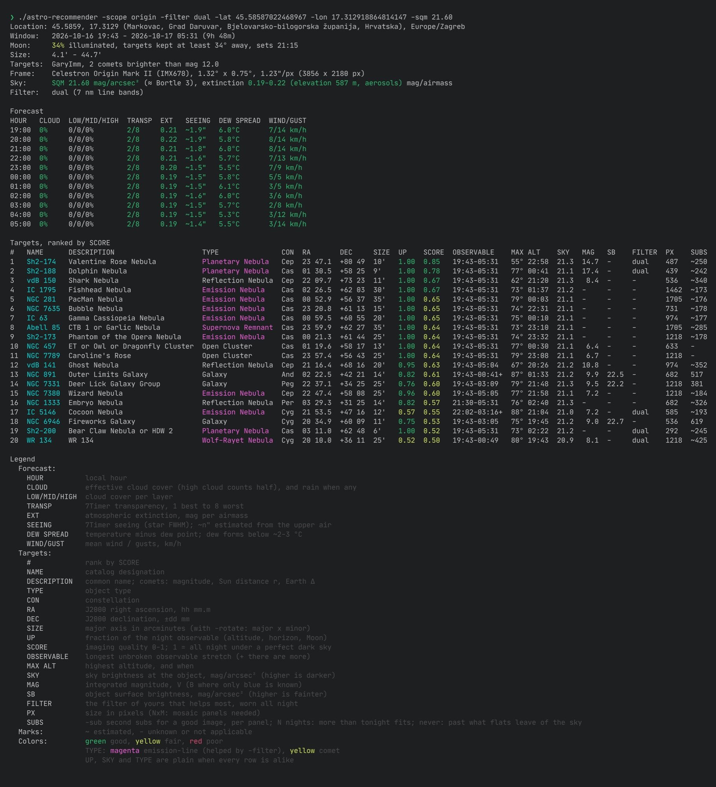
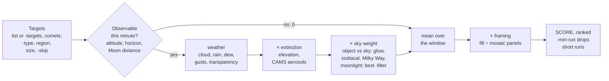

# astro-recommender


[](https://github.com/dkorunic/astro-recommender/releases/latest)
[](go.mod)
[](LICENSE)
[](https://github.com/dkorunic/astro-recommender/actions/workflows/pages.yml)
[](https://astrorecommender.org/)
[](https://hub.xerj.org/contributors/dkorunic.html)

Go CLI, terminal UI and [browser app](https://astrorecommender.org/) that ranks deep sky objects and bright comets for tonight's imaging window at a given location. Each minute from dusk to dawn is scored from altitude, Moon distance, local horizon, forecast weather, extinction, moonlight, light pollution and the object's own surface brightness. Started as a port of the deep sky part of [uptonight](https://github.com/mawinkler/uptonight).

Single static binary; catalogues and time-zone data are embedded; no API key required. Astronomy is hand-rolled and tested against IAU SOFA ([Accuracy](#accuracy)).



## Contents

- [Features](#features)
- [Install](#install)
- [In the browser](#in-the-browser)
- [In the terminal](#in-the-terminal)
- [Usage](#usage)
  - [Output](#output)
  - [Examples](#examples)
  - [Flags](#flags)
  - [Filters](#filters)
  - [Cameras](#cameras)
  - [Smart telescopes](#smart-telescopes)
  - [Target lists](#target-lists)
  - [Comets](#comets)
  - [Night plan](#night-plan)
  - [Local horizon](#local-horizon)
  - [Clear night alerts](#clear-night-alerts)
- [How objects are ranked](#how-objects-are-ranked)
  - [Accuracy](#accuracy)
  - [Formulas and references](#formulas-and-references)
- [Comparison with other tools](#comparison-with-other-tools)
- [Privacy](#privacy)
- [Credits](#credits)

## Features

- **Window**: astronomical dusk to dawn (`-twilight nautical` for −12°), narrowed with `-from`/`-to`; polar nights and date-line zones handled.
- **Observability per minute**: altitude limits, Moon separation, `-horizon` profile, and field rotation on alt-az mounts.
- **Score**: forecast sky quality × extinction × SNR against a pristine sky, summed over observable minutes.
- **Sky model**: Krisciunas & Schaefer dark sky, Winkler (2022) moonlight, zodiacal and galactic light per target direction, solar-cycle airglow, lunar eclipses.
- **Weather**: Open-Meteo cloud layers, rain, dew, gusts; 7Timer transparency; CAMS aerosols; seeing estimated from ECMWF upper-air levels and calibrated against ESO DIMM data.
- **Filters** (`-filter`): dual, tri, quad, Hα, [O III], [S II], CLS, L-Pro. Each target is scored through each filter you own, and the best is named.
- **Framing**: [21 smart telescopes](#smart-telescopes), [45 camera sensors](#cameras) or any custom field/scale; mosaics (`-mosaic`), camera rotation (`-rotate`), core framing of 11 large objects.
- **SUBS**: sub-exposure count per target from the same per-minute sky, optics, QE, read noise, dark current and per-channel colour response.
- **Catalogues**: [34 lists](#target-lists), 44,020 entries (about 32,000 distinct objects), or your own YAML; comets from MPC with COBS magnitude correction.
- **Night plan** (`-plan`), **clear night alerts** ([`astro-notify`](#clear-night-alerts)), **N.I.N.A. export** (`-csv`), **ASIAIR plan** (`-asiair`), **JSON** (`-json`).
- **Offline mode** with the five `-no-*` flags; deterministic output.

## Install

Prebuilt binaries for Linux, macOS and Windows: [Releases](https://github.com/dkorunic/astro-recommender/releases). The archives include `astro-notify`.

```sh
go install github.com/dkorunic/astro-recommender@latest   # Go 1.27+
go install github.com/dkorunic/astro-recommender/cmd/astro-notify@latest

brew tap dkorunic/tap && brew install astro-recommender   # macOS, Linux; both binaries
brew install --cask dkorunic/tap/astro-recommender        # macOS cask
```

From a checkout, with [Task](https://taskfile.dev/):

```sh
task build       # format, then static PGO binary (default.pgo) and astro-notify
task test
task test-wasm   # the browser build's tests, under Node
task lint        # golangci-lint
task pgo         # regenerate default.pgo from the offline scoring benchmarks
```

## In the browser

**https://astrorecommender.org/** runs the same program as WebAssembly. Every flag is a form field, generated from `-h`.

- `-targets`, `-horizon` and `-skip` take uploaded files.
- The URL carries the form after each run, behind the `#`, so links can be shared.
- Results are cards with a DSS2 picture, Aladin Lite link, altitude curve with the Moon's, and SUBS; the text report is under Full report.
- The DarkSkySites lookup needs no key of your own (`-no-sqm` skips it).
- Dark, light and red night-vision themes.

Differences from the CLI: nothing is cached (comet elements are fetched on each run), and comet magnitudes are MPC's alone, as COBS does not allow cross-origin requests. See [Privacy](#privacy) for what is sent where.

## In the terminal

With both stdin and stdout on a terminal, the program opens an interactive view: night summary, weather and plan on the left (from 110 columns), target cards, and the selected target's DSS2 picture (Kitty graphics where supported, else half-blocks) and altitude curve with the Moon's.

| Key | Action |
|---|---|
| `↑` `↓` (`k` `j`), PgUp PgDn | select a target |
| `/` | find by name, description, type or constellation |
| `s` | sort by score, peak time, altitude, size or name |
| `←` `→` (`[` `]`) | previous or next night, computed afresh |
| `t` | back to the first night |
| `o`, Enter | open in Aladin Lite |
| `i` | toggle half-blocks / Kitty graphics |
| `r` | red night vision |
| `w` | warnings (also printed on exit) |
| `?` | all keys |
| `q` | quit |

Tables are printed instead with `-no-tui`, `-json`, `-csv`, `-asiair`, a pipe or redirect, or `TERM=dumb`.

## Usage

```sh
astro-recommender -lat 45.815 -lon 15.982 -scope origin -filter dual -bortle 6 -n 5 -date 2026-11-13 -no-tui
```

```
Location: 45.8150, 15.9820 (Mjesni odbor Zrinjevac, Gradska četvrt Donji grad, Zagreb, Grad Zagreb, Hrvatska), Europe/Zagreb
Window:   2026-11-13 18:11 - 2026-11-14 05:11 (11h 00m)
Moon:     19% illuminated, targets kept at least 19° away (down to 6° through a filter), sets 19:09
Size:     4.1' - 44.7'
Targets:  GaryImm, 1 comet brighter than mag 12.0
Frame:    Celestron Origin Mark II (IMX678), 1.32° x 0.75°, 1.23"/px (3856 x 2180 px), 2.3 px per 2.9" star (well sampled), alt-az (field rotation limits large objects high up)
Sky:      Bortle 6 (zenith 19.95 mag/arcsec²), extinction 0.23 (elevation 126 m, aerosols) mag/airmass, airglow 0.02 mag brighter (solar flux 112 sfu, 30-day mean)
Filter:   dual (7 nm line bands)

Forecast
HOUR   CLOUD       LOW/MID/HIGH  TRANSP  EXT   SEEING  DEW SPREAD  WIND/GUST
18:00  100% 0.3mm  18/99/99%     -       0.23  ~3.1"   4.1°C       4/12 km/h
19:00  99%         0/98/99%      -       0.23  ~3.7"   3.7°C       5/7 km/h
20:00  99%         0/99/99%      -       0.23  ~3.6"   3.0°C       5/7 km/h
21:00  100%        0/99/100%     -       0.23  ~3.1"   2.3°C       3/7 km/h
22:00  100%        0/100/100%    -       0.23  ~2.7"   1.8°C       2/1 km/h
23:00  84%         0/67/100%     -       0.23  ~2.6"   1.5°C       1/1 km/h
00:00  66%         0/33/100%     -       0.23  ~2.6"   1.3°C       1/1 km/h
01:00  50%         0/0/100%      -       0.23  ~2.7"   1.1°C       1/5 km/h
02:00  52%         10/0/94%      -       0.23  ~2.6"   0.9°C       2/5 km/h
03:00  56%         21/0/89%      -       0.23  ~2.4"   0.8°C       2/5 km/h
04:00  60%         31/0/83%      -       0.23  ~2.2"   0.7°C       3/5 km/h
05:00  57%         41/0/55%      -       0.23  ~1.9"   0.4°C       3/5 km/h

Targets, ranked by SCORE
#  NAME     DESCRIPTION              TYPE              CON  RA       DEC     SIZE  UP    SCORE  OBSERVABLE   MAX ALT    SKY   MAG   SB    STAR       FILTER  PX    SUBS
1  IC 1795  Fishhead Nebula          Emission Nebula   Cas  02 26.5  +62 03  30'   1.00  0.16   18:11-05:11  74° 22:53  19.7  -     -     -          dual    1462  ~739
2  Sh2-254  Mushroom Nebula          Emission Nebula   Ori  06 12.0  +18 03  20'   0.63  0.16   22:17-05:11  62° 02:37  19.6  -     -     -          dual    974   ~474
3  IC 63    Gamma Cassiopeia Nebula  Emission Nebula   Cas  00 59.5  +60 55  20'   0.97  0.15   18:11-04:53  75° 21:25  19.7  -     -     γ Cas 2.5  dual    974   ~802
4  Sh2-174  Valentine Rose Nebula    Planetary Nebula  Cep  23 47.1  +80 49  10'   1.00  0.14   18:11-05:11  55° 20:13  19.7  14.7  -     -          dual    487   ~1087
5  NGC 281  PacMan Nebula            Emission Nebula   Cas  00 52.9  +56 37  35'   0.92  0.14   18:11-04:19  79° 21:19  19.7  -     26.4  -          dual    1705  ~837
```

### Output

| Column | Meaning |
|---|---|
| DESCRIPTION | Common names, cut to 40 characters |
| TYPE, CON | Object type; IAU constellation, computed from the boundaries |
| RA, DEC | J2000 `hh mm.m`, `±dd mm`; a comet's mid-window position |
| SIZE | Major axis in arcminutes; `major x minor` with `-rotate` |
| UP | Fraction of the window that meets all observability limits (uptonight's FOTO; JSON `foto`) |
| SCORE | 0–1; decides the order. 1 is a perfect sky for the whole window |
| OBSERVABLE | Longest unbroken observable stretch; `+` marks further, shorter ones |
| MAX ALT | Highest altitude in the window and its time |
| SKY | Mean sky brightness at the object while observable, V mag/arcsec², unfiltered |
| MAG | Integrated V; trailing `B` for B magnitude; a comet's estimate |
| SB | Object surface brightness, V mag/arcsec²; none for star clusters |
| STAR | Brightest star (V ≤ 4.0) or planet that can fall in the frame |
| FILTER | Best filter, with `-filter`; `none` if no filter helps |
| PX | Size in pixels, with framing; a mosaic grid such as `2x1` follows |
| SUBS | Subs for stacked SNR 10 per arcsec² through FILTER (per panel), with framing |

Marks: `~` estimated, `-` unknown or not applicable. In SUBS, `N nights` means more subs than fit tonight, `never` means the `-residual` ceiling caps the stack.

Narrow terminals drop columns in this order: STAR, RA+DEC, CON, UP, MAG, SB, SKY, SIZE, PX, TYPE, MAX ALT, FILTER (with framing SIZE goes right after SB). Colours follow `NO_COLOR`, `CLICOLOR_FORCE=1` and `TERM=dumb`. Warnings go to stderr.

**`-json`** prints one document: `location`, `window`, `moon`, `sky`, `frame`, `forecast`, `conditions` (the forecast as the scored minutes read it), `plan`, `targets`. Unknown values are omitted. A night with nothing to plan gives `{"message": "…", "targets": []}`. A target's `subs` holds `modest`, `good` and `best` (SNR 5, 10, 20), `max`, `sub`, `snrPerSub` and `panels`.

**`-csv`** prints Telescopius's observing-list format, which [N.I.N.A.](https://nighttime-imaging.eu/)'s simple sequencer imports: the top `-n` targets, or with `-plan` the planned ones in order, at J2000.

**`-asiair`** prints the same targets as text to paste into the ZWO ASIAIR's Plan mode Import. ZWO does not document the format, and it has not been tested on a device. A mosaic is its centre only, at angle 0, with a warning on stderr.

With framing, the header's `Frame:` line and JSON `frame` judge the pixel scale against the night's mean zenith seeing and, for a known aperture, diffraction: 2–3 pixels across a star is well sampled.

### Examples

```sh
L="-lat 45.815 -lon 15.982"

astro-recommender $L                                                # tonight, GaryImm list, dark sky, no framing
astro-recommender $L -scope seestar-s50 -filter dual -bortle 6      # smart telescope, built-in filter, suburban sky
astro-recommender $L -sqm 20.4                                      # measured zenith brightness
astro-recommender $L -date 2026-12-12 -from 22:00 -to 02:00         # another evening, part of the night
astro-recommender $L -scope dwarf-3 -filter dual -plan 2h           # one target per 2-hour block
astro-recommender $L -camera imx571 -focal 400 -aperture 80 -sub 180 -filter dual     # own telescope, camera preset, SUBS
astro-recommender $L -focal 400 -sensor 23.5x15.6 -pixel 3.76       # own camera, framing only
astro-recommender $L -focal 400 -sensor 23.5x15.6 -pixel 3.76 -mosaic 6 -rotate       # mosaics, rotatable camera
astro-recommender $L -fov 10x7 -scale 6 -min-px 50                  # lens field given directly
astro-recommender $L -list LDN -size-min 0                          # catalogue with small or unsized objects
astro-recommender $L -list OpenNGC -size-min 0 -ra "20 30" -dec 40 -tol 15            # one region of the sky
astro-recommender $L -scope vespera-pro -filter dual -list HASH -min-px 30 -n 30      # planetary nebulae
astro-recommender $L -targets my-targets.yaml                       # own list
astro-recommender $L -horizon horizon.txt -alt-min 20               # measured horizon
astro-recommender $L -comet-mag 8                                   # only bright comets
astro-recommender $L -scope origin -plan 2h -csv > tonight.csv      # N.I.N.A. sequence
astro-recommender $L -scope origin -plan 2h -asiair                 # ASIAIR plan, to paste
astro-recommender -lat -23.3 -lon 16.3 -date 2026-06-15 -bortle 1 -extinction 0.15    # remote site; zone from coordinates
astro-recommender $L -no-weather -no-geocode -no-sqm -no-comets -no-solar             # offline, deterministic
```

### Flags

`astro-recommender -h` prints the same flags, grouped.

| Flag | Default | Description |
|------|---------|-------------|
| `-lat`, `-lon` | required | Degrees, north and east positive |
| `-tz` | from location | IANA zone for displayed times; offline lookup, falling back to the system zone |
| `-date` | tonight | Evening, `YYYY-MM-DD`. Without it, a run during the night plans the rest of it |
| `-from`, `-to` | dusk, dawn | Window in local `HH:MM`, clamped to the night. Times before noon are the next morning |
| `-twilight` | `astronomical` | `astronomical` (Sun < −18°) or `nautical` (< −12°) |
| `-min-run` | `0` | Keep only targets observable unbroken for this long, e.g. `1h` |
| `-n` | `20` | Objects listed |
| `-plan` | off | Night plan with blocks of this length, e.g. `2h` |
| `-list` | `GaryImm` | [Built-in list](#target-lists) |
| `-targets` | none | Own YAML file; overrides `-list` |
| `-skip` | none | File of names to leave out, one per line, `#` comments; case and spaces ignored |
| `-type` | all | Comma-separated: `galaxy`, `cluster`, `nebula`, `emission`, `comet`, `other` |
| `-size-min`, `-size-max` | `10`, `300` | Arcminutes. With framing: `-min-px` × scale up to what the frame or mosaic holds |
| `-ra`, `-dec` | | Keep targets near this J2000 position (hours and degrees, decimal or `"20 30 00"`) |
| `-tol` | `10` | With `-ra`/`-dec`, degrees per axis, above 0 and at most 180 |
| `-comet-mag` | `12` | Include comets brighter than this |
| `-alt-min`, `-alt-max` | `30`, `80` | Altitude limits, 0–90° |
| `-horizon` | none | [Local horizon file](#local-horizon) |
| `-bortle` | `0` (dark) | Bortle class 1–9, sets zenith brightness |
| `-sqm` | unset | Measured zenith brightness in mag/arcsec²; overrides `-bortle`. Without either, looked up on [DarkSkySites](https://www.darkskysites.com/api-access) when `DARKSKYSITES_API_KEY` is set; else 22.0 |
| `-extinction` | auto | Mag per airmass. Default: per hour from elevation and CAMS aerosols, `0.2` when unavailable |
| `-filter` | none; `-scope`'s built-in | Comma-separated [filters](#filters) you own |
| `-filter-nm` | `7` | With a line filter: band width in nm, 1–30; else a `-scope`'s built-in widths |
| `-filter-std` | off | With a line filter: standard filters whose bands shift blue in a fast beam ([details](MODELS.md#filters-in-a-fast-beam)) |
| `-scope` | off | [Smart telescope](#smart-telescopes) preset; turns on framing |
| `-camera` | off | [Sensor preset](#cameras), with `-focal`; not with `-scope` |
| `-focal` | off | Focal length, mm |
| `-sensor` | off | Sensor `WxH` in mm; with `-focal`, sets the field |
| `-pixel` | off | Pixel size in µm; with `-focal`, sets the scale |
| `-fov` | `-scope`'s | Field `WxH` in degrees, up to 180 |
| `-scale` | `-scope`'s | Pixel scale, 0.01–1000 ″/px |
| `-min-px` | `200` | With framing: minimum object size in pixels |
| `-mosaic` | `1` | With framing: most panels per object, 1–25; 10% overlap, score divided among panels |
| `-rotate` | off | With framing: camera can rotate, so a known minor axis counts |
| `-aperture` | `-scope`'s | With framing: aperture, mm |
| `-obstruction` | `-scope`'s, 0 with `-aperture` | With framing: central obstruction, mm |
| `-throughput` | by design | With framing: optics' transmission, (0, 1]; refractor 0.88, prime-focus mirror 0.81, other 0.85 |
| `-qe`, `-read-noise` | chip's | With framing: peak QE (0, 1]; read noise in e⁻ |
| `-mono` | off | With framing: monochrome camera |
| `-dark` | chip's, else `0.16` | With framing: dark current, e⁻/s per pixel at 25 °C, doubling every 5 °C |
| `-sensor-temp` | uncooled | With framing: cooled sensor temperature, −60 to 60 °C. Uncooled is 10 °C above forecast air |
| `-sub` | `-scope`'s | With framing: sub length, 0.001–3600 s |
| `-reject` | `0.15` | With framing: share of subs discarded, 0–0.9 |
| `-stack` | `mean` with `-scope`, else `weighted` | With framing: `mean` or `weighted` (by SNR²) |
| `-mount` | `-scope`'s, else `eq` | With framing: `altaz`, `derotated` or `eq`. `altaz` without `-scope` needs `-sub` |
| `-residual` | `0.002` | With framing: sky share left by flats and gradient removal, 0–0.05; caps stacked SNR |
| `-no-weather`, `-no-geocode`, `-no-sqm`, `-no-comets`, `-no-solar` | off | Skip that network source |
| `-no-tui` | off | Print tables on a terminal |
| `-json`, `-csv`, `-asiair` | off | [Alternative output](#output); mutually exclusive |
| `-version` | | Print version, commit and build time |

Framing is on with any of `-scope`, `-fov`, `-scale`, `-focal`. Flags marked "with framing" are errors without it. SUBS needs an optical and camera description: without `-scope`, give `-aperture` and `-camera` (or `-mono` with `-qe` and `-read-noise`). The header's `Frame:` line names whatever is missing.

### Filters

| `-filter` | Passes | Popular filters | `-filter-nm` |
|---|---|---|---|
| `ha` | Hα | Narrowband Hα from Astronomik, Baader, Antlia, Chroma, Optolong | 3–7 |
| `oiii` | [O III] | Narrowband [O III] from the same makers | 3–7 |
| `sii` | [S II] | Narrowband [S II] from the same makers | 3–7 |
| `dual` | Hα + [O III] | Optolong L-eXtreme (7 nm), L-Ultimate (3 nm); Antlia ALP-T (5 nm); ZWO Duo-Band; STC Astro Duo-NB | the filter's band width |
| `tri` | Hα + Hβ + [O III] | Optolong L-eNhance (one 24 nm band over Hβ and [O III], 10 nm Hα) | 10–12, an approximation |
| `quad` | Hα + Hβ + [O III] + [S II] | Optolong L-Quad Enhance; Radian Triad Ultra | the filter's band width |
| `cls` | 450–520 + 640–690 nm | Astronomik CLS / CLS-CCD; Optolong CLS / CLS-CCD; close: IDAS LPS-D2 | — |
| `lpro` | 400–700 nm with the lamp lines notched | Optolong L-Pro; IDAS LPS-D1, LPS-P2, LPS-D3; milder: Baader Moon & Skyglow | — |
| none | 400–700 nm | Luminance and UV/IR-cut filters (Astronomik L-2/L-3, Baader UV/IR Cut), RGB sets: leave `-filter` out | — |

`-filter-nm` is one width for every line filter given, so list filters of similar width together. Below about f/3, give `-filter-std` unless your filters are made for fast optics. `cls` and `lpro` model the sky glow as white LEDs, so they help only emission nebulae ([MODELS.md](MODELS.md#broadband-filters)).

### Cameras

`-camera` with `-focal` sets `-sensor`, `-pixel`, `-qe`, `-read-noise` and a colour chip's per-line response from its maker's figures. `-mono` selects the mono version. Explicit flags win; `-aperture` and `-sub` stay yours.

| `-camera` | Cameras | Pixels | Colour: peak QE, read noise | Mono |
|---|---|---|---|---|
| `ar0130` | ASI120MM Mini, Omegon Guide 1200, Lacerta MGEN-3 | 3.75 µm, 1280 × 960 | – | 78%, 3.9 e⁻ at gain 33 |
| `gsense4040` | QHY4040 Pro FSI, SBIG Aluma AC4040, Moravian C4-16000 | 9 µm, 4096 × 4096 | – | 74% (QHY), 4.0 e⁻ at gain 31 (QHY) |
| `gsense4040bsi` | QHY4040 Pro BSI | 9 µm, 4096 × 4096 | – | 90% (QHY), 2.3 e⁻ at gain 50 (QHY) |
| `icx674` | Starlight Xpress Trius PRO-674 (CCD) | 4.54 µm, 1940 × 1460 | – | 77%, 3.5 e⁻ |
| `icx694` | Starlight Xpress Trius PRO-694 (CCD) | 4.54 µm, 2750 × 2200 | – | 77%, 3.5 e⁻ |
| `icx695` | QHY695A (CCD) | 4.54 µm, 2758 × 2208 | – | 79% (QHY), 4.5 e⁻ |
| `icx814` | Starlight Xpress Trius PRO-814 (CCD) | 3.69 µm, 3388 × 2712 | – | 77%, 3.0 e⁻ |
| `icx825` | Starlight Xpress Trius PRO-825, Ultrastar PRO, Oculus PRO (CCD) | 6.45 µm, 1392 × 1040 | – | 75%, 3.5 e⁻ |
| `icx829` | Starlight Xpress Lodestar PRO (CCD) | 8.6 × 8.3 µm, 752 × 580 | – | 77%, 5.5 e⁻ |
| `imx174` | ASI174MM | 5.86 µm, 1936 × 1216 | – | 77%, 3.5 e⁻ at gain 300 |
| `imx183` | ASI183MM Pro, ASI183MM, ASI183GT | 2.4 µm, 5496 × 3672 | – | 84%, 2.1 e⁻ at gain 120 |
| `imx224` | ASI224MC, Unistellar eVscope / eQuinox | 3.75 µm, 1304 × 976 | 78%, 1.6 e⁻ at gain 60 | – |
| `imx249` | ToupTek GPM174M | 5.86 µm, 1920 × 1200 | – | 89%, 4.0 e⁻ at gain 1778 (ToupTek) |
| `imx250` | QHY550M | 3.45 µm, 2460 × 2070 | – | 70% (QHY), 2.1 e⁻ at gain 200 (QHY) |
| `imx252` | Moravian C1-3000 | 3.45 µm, 2064 × 1544 | 60% (FLIR's EMVA 1288), 2.0 e⁻ at gain 240 (Moravian) | 64% (FLIR's EMVA 1288), 2.0 e⁻ at gain 240 (Moravian) |
| `imx287` | Omegon veLOX 287 M | 6.9 µm, 728 × 544 | – | 71% (Altair), 1.41 e⁻ (Altair) |
| `imx290` | ToupTek G3M290C/M | 2.9 µm, 1936 × 1096 | 81% (ToupTek), 1.65 e⁻ at gain 60 | 81% (ToupTek), 1.65 e⁻ at gain 60 |
| `imx294` | ASI294MC Pro | 4.63 µm, 4144 × 2822 | 75%, 1.7 e⁻ at gain 120 | – |
| `imx366` | ASI4400MC Pro, ToupTek SkyEye45AC Plus | 4.40 µm, 8192 × 5460 | 80%, 1.7 e⁻ at gain 136 | – |
| `imx410` | ASI2400MC Pro | 5.94 µm, 6072 × 4042 | 80%, 1.5 e⁻ at gain 140 | – |
| `imx428` | ToupTek ATR428M/C | 4.5 µm, 3200 × 2200 | 79%, 2.4 e⁻ at gain 100 (ToupTek) | 79%, 2.5 e⁻ at gain 100 (ToupTek) |
| `imx432` | ASI432MM | 9 µm, 1608 × 1104 | – | 79%, 4.3 e⁻ at gain 140 |
| `imx455` | ASI6200MC/MM Pro, Player One Zeus 455 | 3.76 µm, 9576 × 6388 | 80%, 1.35 e⁻ at gain 100 | 91%, 1.35 e⁻ at gain 100 |
| `imx461` | ASI461MM Pro | 3.76 µm, 11656 × 8750 | – | 91%, 1.45 e⁻ at gain 100 |
| `imx178` | Celestron Origin 2023, Vaonis Stellina, ASI178MC, ToupTek G3M178C/M | 2.4 µm, 3096 × 2080 | 70% (second-hand), 1.7 e⁻ at gain 100 | 81% (ToupTek), 1.7 e⁻ at gain 100 |
| `imx462` | ASI462MC/MM, Seestar S50, Vespera | 2.9 µm, 1936 × 1096 | 81%, 1.05 e⁻ at gain 80 | 89%, 1.05 e⁻ at gain 80 |
| `imx464` | Player One Neptune-C II | 2.9 µm, 2712 × 1538 | 90%, 1.2 e⁻ at gain 83 | – |
| `imx482` | ASI482MC | 5.8 µm, 1920 × 1080 | 85%, 4.5 e⁻ at gain 80 | – |
| `imx485` | ASI485MC | 2.9 µm, 3840 × 2160 | 85%, 2.3 e⁻ at gain 80 | – |
| `imx492` | ASI294MM Pro (2×2 binned) | 4.63 µm, 4144 × 2822 | – | 90%, 1.8 e⁻ at gain 120 |
| `imx530` | QHY530M Pro II | 2.74 µm, 5328 × 4608 | – | 88% (QHY), 1.3 e⁻ at gain 200 (QHY) |
| `imx533` | ASI533MC/MM Pro | 3.76 µm, 3008 × 3008 | 80%, 1.5 e⁻ at gain 100 | 91%, 1.5 e⁻ at gain 100 |
| `imx568` | QHY5III568C/M | 2.74 µm, 2472 × 2064 | 53% (FLIR's EMVA 1288), 1.54 e⁻ at gain 250 (QHY) | 67% (FLIR's EMVA 1288), 1.54 e⁻ at gain 250 (QHY) |
| `kaf16200` | Moravian G3-16200/16200C, Starlight Xpress Trius SX-46 (CCD) | 6 µm, 4540 × 3640 | 40% (onsemi), 10 e⁻ (Moravian) | 58%, 9 e⁻ |
| `kaf16803` | Starlight Xpress Trius SX-56, Moravian G4-16000 (CCD) | 9 µm, 4096 × 4096 | – | 60% (onsemi), 9 e⁻ |
| `mn34230` | ASI1600MM/MC, QHY163M, Meade DSI IV, Explore Scientific Deep Sky 16MP | 3.8 µm, 4656 × 3520 | 60%, 1.8 e⁻ at gain 139 | 60%, 1.8 e⁻ at gain 139 |
| `imx571` | ASI2600MC/MM Pro, ASI2600MC Duo, ASI2600MC Air | 3.76 µm, 6248 × 4176 | 80%, 1.4 e⁻ at gain 100 | 91%, 1.4 e⁻ at gain 100 |
| `imx585` | ASI585MC/MM Pro, ASI585MC/MM, ASI585MC Air, Seestar S30 Pro, Vespera II, Vespera 3, Vaonis Atlas, ORBIS 60EDX | 2.9 µm, 3840 × 2160 | 91%, 1.0 e⁻ at gain 200 | 91%, 1.0 e⁻ at gain 200 |
| `imx662` | ASI662MC/MM, Seestar S30, DWARF mini | 2.9 µm, 1920 × 1080 | 91%, 1.2 e⁻ at gain 200 | 91%, 1.2 e⁻ at gain 200 |
| `imx664` | ASI664MC | 2.9 µm, 2704 × 1536 | 91%, 0.8 e⁻ at gain 252 | – |
| `imx676` | ASI676MC/MM, Vespera Pro, Vespera Pro 2 | 2.0 µm, 3552 × 3552 | 83%, 0.75 e⁻ at gain 180 | 83%, 0.75 e⁻ at gain 180 |
| `imx678` | ASI678MC/MM, Celestron Origin Mark II, DWARF 3 | 2.0 µm, 3840 × 2160 | 83%, 0.9 e⁻ at gain 182 | 83%, 0.9 e⁻ at gain 182 |
| `imx715` | ASI715MC | 1.45 µm, 3864 × 2192 | 80%, 1.2 e⁻ at gain 100 | – |
| `os08b10` | Seestar S50 Pro | 2.9 µm, 3840 × 2160 | 80% (OmniVision's Nyxel 2 chart), 0.84 e⁻ at gain 150 (measured by Cuiv) | – |
| `sc2210` | ASI220MM Mini (SmartSens) | 4.0 µm, 1920 × 1080 | – | 92%, 1.03 e⁻ at gain 106 |

Read noise is at the maker's deep-sky gain. Colour responses are digitized from makers' QE charts by `scripts/qe_digitize.py`. The `os08b10` figures are the least certain: a chart attributed to the chip by a ZWO user group slide and [Cuiv's read noise measurement](https://seestars50pro.base44.app/). Per-chip sources are in `internal/config/cameras.go` and [MODELS.md](MODELS.md#camera-presets).

### Smart telescopes

`-scope` sets optics, frame, sub length, mount, built-in filter and, where the sensor is a [camera preset](#cameras), QE, read noise and colour response. Explicit flags win; `-camera` is an error with it.

| `-scope` | Telescope | Sensor | Optics | Frame | Sub | SUBS |
|---|---|---|---|---|---|---|
| `draco` | DwarfLab Draco | OmniVision OV50Q40 | 90 mm f/3.8 | 1.65° × 1.24°, 1.45″/px | 60 s | with `-qe`, `-read-noise`, `-obstruction` |
| `atlas` | Vaonis Atlas (one module) | IMX585 | 80 mm f/4.5 | 1.77° × 1.00°, 1.66″/px | 30 s | yes |
| `dwarf-2` | DwarfLab DWARF II | IMX415 | 24 mm f/4.2 | 3.19° × 1.79°, 2.99″/px | 15 s | with `-qe`, `-read-noise` |
| `dwarf-3` | DwarfLab DWARF 3 | IMX678 | 35 mm f/4.3 | 2.93° × 1.65°, 2.75″/px | 15 s | yes |
| `dwarf-mini` | DwarfLab DWARF mini | IMX662 | 30 mm f/5.0 | 2.13° × 1.20°, 3.99″/px | 15 s | yes |
| `evscope` | Unistellar eVscope / eQuinox | IMX224 | 114 mm f/3.9 | 0.62° × 0.47°, 1.72″/px | 4 s | with `-qe`, `-read-noise`, `-obstruction` |
| `evscope-2` | Unistellar eVscope 2 / eQuinox 2 | IMX347 | 114 mm f/3.9 | 0.76° × 0.57°, 1.33″/px | 4 s | with `-qe`, `-read-noise`, `-obstruction` |
| `odyssey` | Unistellar Odyssey / Odyssey Pro | unnamed, 1.45 µm | 85 mm f/3.8 | 0.75° × 0.56°, 0.93″/px | 4 s | with `-qe`, `-read-noise`, `-obstruction` |
| `orbis-60edx` | Sky-Watcher ORBIS 60EDX | IMX585 | 60 mm f/5.0 | 2.13° × 1.20°, 1.99″/px | 10 s | yes |
| `origin` | Celestron Origin Mark II | IMX678 | 152 mm f/2.2, 77 mm obstruction | 1.32° × 0.75°, 1.23″/px | 10 s | yes |
| `origin-mk1` | Celestron Origin 2023 | IMX178 | 152 mm f/2.2, 63 mm obstruction | 1.27° × 0.85°, 1.48″/px | 10 s | yes |
| `seestar-s30` | ZWO Seestar S30 | IMX662 | 30 mm f/5.0 | 2.13° × 1.20°, 3.99″/px | 10 s | yes |
| `seestar-s30-pro` | ZWO Seestar S30 Pro | IMX585 | 30 mm f/5.3 | 3.99° × 2.24°, 3.74″/px | 10 s | yes |
| `seestar-s50` | ZWO Seestar S50 | IMX462 | 50 mm f/5.0 | 1.28° × 0.72°, 2.39″/px | 10 s | yes |
| `seestar-s50-pro` | ZWO Seestar S50 Pro | OmniVision OS08B10 | 50 mm f/5.2 | 2.45° × 1.38°, 2.30″/px | 10 s | yes (approximate: `os08b10`) |
| `stellina` | Vaonis Stellina | IMX178 | 80 mm f/5.0 | 1.06° × 0.72°, 1.24″/px | 10 s | yes |
| `vespera` | Vaonis Vespera | IMX462 | 50 mm f/4.0 | 1.60° × 0.90°, 2.99″/px | 10 s | yes |
| `vespera-2` | Vaonis Vespera II | IMX585 | 50 mm f/5.0 | 2.55° × 1.44°, 2.39″/px | 10 s | yes |
| `vespera-3` | Vaonis Vespera 3 | IMX585 | 50 mm f/4.9 | 2.60° × 1.46°, 2.44″/px | 10 s | yes |
| `vespera-pro` | Vaonis Vespera Pro | IMX676 | 50 mm f/5.0 | 1.62° × 1.62°, 1.65″/px | 10 s | yes |
| `vespera-pro-2` | Vaonis Vespera Pro 2 | IMX676 | 50 mm f/4.9 | 1.65° × 1.65°, 1.68″/px | 10 s | yes |

Values are the makers' as of October 2026; exceptions are commented in `internal/config/scopes.go`. Mounts are `altaz`, except `derotated` for the Draco and ORBIS 60EDX.

Where SUBS lists flags, the maker does not publish those values and SUBS is `-` without them. Built-in duo-band filters are the `-filter` default: Seestars Hα 20 / [O III] 30 nm, DWARF 3 and mini 15 / 30 nm, Draco 13 / 13 nm. Other optics or another camera on a `-scope` need the flags named on the header's `Frame:` line.

### Target lists

Pick one with `-list`; names are case-insensitive.

| List | Objects | Contents |
|------|---------|----------|
| `GaryImm` (default) | 206 | Gary Imm's top astrophotography targets and the top of his Compendium |
| `GaryImmFull` | 3145 | Gary Imm's Deep Sky Compendium (2026, rev. 6b) |
| `Messier` | 110 | Messier catalogue |
| `Caldwell` | 109 | Caldwell catalogue (`C N`) |
| `Herschel400` | 400 | Astronomical League's Herschel 400 |
| `Pensack500` | 502 | Don Pensack's 500 best deep sky objects |
| `OpenNGC` | 8373 | NGC, from [OpenNGC](https://github.com/mattiaverga/OpenNGC) |
| `OpenIC` | 5590 | IC, from OpenNGC |
| `LBN` | 1116 | Lynds' bright nebulae |
| `LDN` | 1764 | Lynds' dark nebulae |
| `Barnard` | 349 | Barnard's dark nebulae |
| `DCld` | 1101 | Hartley et al. 1986 southern dark clouds |
| `CG` | 48 | Cometary globules |
| `Sharpless` | 313 | Sharpless H II regions (`Sh2-N`) |
| `RCW` | 181 | RCW southern Hα regions |
| `Gum` | 96 | Gum southern H II regions |
| `Ced` | 330 | Cederblad bright diffuse nebulae |
| `Henize` | 372 | Henize Magellanic Cloud emission nebulae (`LMC N44`) |
| `DEM` | 525 | Davies, Elliott & Meaburn LMC/SMC Hα regions |
| `SNR` | 98 | Green's 2024 supernova remnants with optical detection |
| `vdB` | 158 | Van den Bergh reflection nebulae |
| `vdBH` | 136 | Van den Bergh & Herbst southern reflection nebulae |
| `MCRN` | 913 | Magakian's merged reflection nebulae |
| `PNnet` | 1016 | [Planetary Nebulae.net](https://planetarynebulae.net/) discoveries and candidates |
| `HASH` | 3994 | [HASH](https://hashpn.space/) planetary nebulae (true, likely, possible) |
| `MWSC` | 3006 | Milky Way Star Clusters (Kharchenko et al. 2013); size is the r1 diameter |
| `Dias` | 1963 | Dias et al. open clusters (v3.5) |
| `Harris` | 157 | Harris 2010 globular clusters |
| `Melotte` | 245 | Melotte clusters (`Mel N`) |
| `Collinder` | 471 | Collinder open clusters (`Cr N`) |
| `Arp` | 338 | Arp's peculiar galaxies |
| `AM` | 5973 | Arp & Madore southern peculiar galaxies and associations |
| `HCG` | 100 | Hickson compact groups |
| `ACO` | 822 | Abell, Corwin & Olowin rich clusters with a redshift (`ACO N`) |

Unknown sizes (`-9999`) count as 0: dropped by the default `-size-min`, kept by `-size-min 0`. Some lists have mostly unsized or very small objects (`MCRN`, `CG`, `AM`), so use `-size-min 0` or a low `-min-px`.

`-targets` reads uptonight-format YAML, one list of entries:

```yaml
- name: NGC 7000
  description: North America Nebula
  type: Emission Nebula
  constellation: Cygnus     # overwritten from the IAU boundaries
  ra: "20 59 17"            # J2000, hh mm ss
  dec: "+44 31 44"          # [+-]dd mm ss
  size: 120                 # major axis, arcminutes; -9999 unknown
  # optional: minor, mag, bmag, surfbr (V), bsurfbr (B), haflux
```

Generators and their sources are in [scripts/README.md](scripts/README.md). After changing a list, run `task lists`; `go test` fails on a stale embedded copy.

### Comets

Added to any list and scored alike, from MPC's [`CometEls.txt`](https://www.minorplanetcenter.net/iau/MPCORB/CometEls.txt) (cached for a day; a stale copy is used if the download fails). Positions are two-body orbits per minute, within 0.003–0.02° of JPL Horizons when both use the same orbit solution. Kept when brighter than `-comet-mag` at mid-window by `m = H + 5·log Δ + 2.5·K·log r`, shifted by the median offset from the last 30 days of [COBS](https://cobs.si/) observations when there are at least three (description then says `(COBS)`). Size limits and framing do not apply.

### Night plan

`-plan 2h` assigns one target to each 2-hour block (and a shorter last block), considering all ranked targets, not only the `-n` listed.

```
TIME         NAME     DESCRIPTION          TYPE               SCORE  PEAK ALT
20:08-22:08  IC 1396  Elephant's Trunk     Dark Nebula        0.67   78° 21:37
22:08-00:08  Sh2-132  Lion Nebula          Wolf-Rayet Nebula  0.92   80° 22:17
00:08-02:08  NGC 281  PacMan Nebula        Emission Nebula    0.66   79° 00:50
```

Greedy assignment per block, then local search (swaps, moves, replacements by unused targets) to a local optimum, modelled on [astrogo](https://github.com/TuSKan/astrogo)'s `SwapOptimizedStrategy`.

### Local horizon

`-horizon FILE` lists azimuth (0 = north, 90 = east) and minimum altitude in degrees; values are interpolated and wrap at north. A minute counts only above both this and `-alt-min`.

```
# azimuth altitude
0    25
45   60   # house
90   35
180  20
270  40   # trees
```

`scripts/terrain2horizon.py LAT LON > horizon.txt` generates one from AWS Terrain Tiles, OpenStreetMap buildings and the Meta/WRI 1 m canopy height map, and prints a panorama on stderr for checking. Options are in [scripts/README.md](scripts/README.md#your-own-horizon).

### Clear night alerts

`astro-notify` runs `astro-recommender -json` once and, on a good night, sends the forecast and targets to Telegram, Discord, Slack and/or a webhook. Run it from cron or a systemd timer, using the same version as `astro-recommender`. Arguments after `--` go to `astro-recommender`.

```sh
export TELEGRAM_BOT_TOKEN=123456:ABC...   # also DISCORD_BOT_TOKEN, SLACK_BOT_TOKEN (chat:write)
astro-notify -chat 12345678,@mychannel -discord-user 80351110224678912 -slack-chat C0123456789 -- -lat 45.8 -lon 16.0 -scope origin -n 15
```

| Flag | Default | Meaning |
|---|---|---|
| `-chat` | `$TELEGRAM_CHAT_IDS` | Comma-separated Telegram chat IDs or @channels |
| `-discord-user` | `$DISCORD_USER_IDS` | Comma-separated Discord user IDs |
| `-slack-chat` | `$SLACK_CHAT_IDS` | Comma-separated Slack channel or user IDs |
| `-webhook` | `$WEBHOOK_URL` | URL to POST the report to |
| `-webhook-format` | `text` | `text`, or `json` as `{"title": ..., "message": ...}` |
| `-webhook-header` | `$WEBHOOK_HEADERS` | `Name: value`, repeatable (the variable holds one per line) |
| `-bin` | `astro-recommender` | Binary to run |
| `-max-cloud` | `10` | Highest effective cloud cover in a clear minute, % |
| `-max-seeing` | `2` | Worst seeing in a clear minute, arcseconds |
| `-min-clear` | `2h` | Shortest clear stretch in which a listed target is observable; a shorter window needs the whole window, at least 30 minutes |
| `-dry-run` | | Print every message style, send nothing; needs no token |

```sh
astro-notify -webhook https://ntfy.sh/mytopic -webhook-header 'Title: Clear night' -- ...
WEBHOOK_HEADERS='X-Gotify-Key: AbCd' astro-notify -webhook https://gotify.example/message -webhook-format json -- ...
WEBHOOK_HEADERS='Authorization: Bearer eyJ...' astro-notify -webhook https://ha.example/api/services/notify/mobile_app_phone -webhook-format json -- ...
```

Behaviour:

- A minute is clear with known cloud and seeing within the limits and no rain; unknown rain counts as none.
- No qualifying stretch, or no night at all: nothing is sent, exit 0. A missing cloud or seeing forecast: exit 1.
- Messages hold as many targets as fit: Telegram 4096 characters and 100 entities, Discord embed 4096, Slack 4000, webhook 4096 bytes.
- Sends run concurrently under a 5-minute limit. A network error, 429 or 5xx is retried once; a `Retry-After` up to a minute is honoured. Any failed destination gives exit 1.
- Webhook redirects are errors, as following one would lose the POST.
- A Discord bot must share a server with the user. A Slack bot must be in a private channel, and in a public one unless it has `chat:write.public`.

## How objects are ranked



`SCORE = framing × Σ(weather × extinction × sky weight) / window minutes`, summed over observable minutes; mean altitude breaks ties. Every formula and source is in [MODELS.md](MODELS.md).

1. **Window.** Sun below the `-twilight` limit, searched from the site's solar noon.
2. **Dropped before scoring.** Size outside limits, outside `-ra`/`-dec`, in `-skip`, or not of a `-type`.
3. **Observable minute.** Altitude within `-alt-min`..`-alt-max`, above `-horizon`, and at least *illumination %* degrees from the Moon while it is up (scaled by a filter's `moonK`, and by the Earth's shadow in an eclipse). On `altaz`, the sub's field rotation must not trail the object's edge by more than a star's FWHM. A target whose longest run is below `-min-run` is dropped.
4. **Weather factor**, per minute:

   | Input | Source | Effect |
   |---|---|---|
   | Cloud | Open-Meteo | `1 − effective cover`; high cloud counts half |
   | Dew spread | Open-Meteo | 4 → 1 °C: ×1 → ×0.7 |
   | Gusts | Open-Meteo | 20 → 40 km/h: ×1 → ×0.5; capped at 3× mean wind, not below 20 km/h |
   | Rain | Open-Meteo | 0 → 0.1 mm/h: ×1 → ×0 |
   | Transparency | 7Timer | class 1 → 8: ×1 → ×0.5, only for hours without CAMS AOD |

   Hours a source does not cover get the covered hours' mean, with a warning; a missing source counts as perfect sky. Weather does not affect UP or OBSERVABLE. Seeing does not affect SCORE; SUBS uses it to blur small objects. When no 60-minute run reaches 20% of a clear sky with seeing under 4″, the text report replaces the target table with the reason (`-json` and `-csv` still list targets).
5. **Extinction.** `10^(−0.4 κ (X − 1))` with Pickering (2002) airmass, `κ = 0.1066 e^(−h/7996 m) + 0.029 + 1.086 AOD₅₅₀`. AOD comes from CAMS (about 5 days ahead, else 0.1), thinned by `e^(−Δz/1.5 km)` for the site's height above the model cell.
6. **Sky brightness** at the target, each minute: zenith from `-sqm`, `-bortle`, DarkSkySites or 22.0; solar-cycle airglow (Noll et al. 2012, not with `-sqm`); Krisciunas & Schaefer (1991) brightening towards the horizon; zodiacal and galactic light for the direction (Leinert et al. 1998); moonlight after Winkler (2022) from phase, distance, altitudes and separation, dimmed in eclipses.
7. **Sky weight.** `min(1, √((S + B_ref) / (S + B)))` with object surface brightness `S`, sky `B` and a pristine 22.0 sky `B_ref`, in linear units. Unknown `S` is sky-limited, `√(B_ref / B)`. Star clusters use no `S`, as their faint members are what a night changes.

   `S` comes from a measured V value, else measured B moved to V, else (`~`) magnitude over the ellipse of the axes for galaxies and nebulae without a star's or cluster's magnitude. Emission nebulae with an Hα flux (Frew et al. 2013 for planetaries; Finkbeiner 2003 for those of 30′ and more without a surface brightness) use its lines instead.
8. **Filters.** Emission-line light is split by typical line ratios per type; the sky by glow, Rayleigh (λ⁻⁴) and aerosol (λ⁻¹·³) moonlight over 400–700 nm. Filtered weight: `min(1, √(w² (S + B_ref) / (w S + B_band)))`, with `w` the share of the object's light passed, and band-specific extinction. Each filter is worn all night; the highest gain wins, or with framing the fewest SUBS. The Moon limit shrinks down to 30% of the unfiltered one. Details: [MODELS.md](MODELS.md#nebula-filters).
9. **Framing.** Full credit for 25–80% of the short side, falling linearly to 0 at no size and at the full short side; objects that do not fit are dropped. `-mosaic` tries every grid and divides by panel count. An object too large for any grid but with a known [core](internal/catalog/core.go) is framed at the core.

SUBS is modelled in [MODELS.md](MODELS.md#sub-exposure-estimate). Weather ramps, framing curve, line ratios and typical surface brightnesses are heuristics; treat SCORE as an ordering, not an absolute measure.

### Accuracy

`TestSOFA`, `TestSOFAGalactic`, `TestSOFAWindow` and `TestScoreSOFA` enforce these limits against [SOFA](http://iausofa.org) through the test-only [gofa](https://github.com/hebl/gofa); `TestSOFAReference` pins SOFA's own validation results.

| Quantity | Formula | Difference from SOFA |
|---|---|---|
| Sidereal time | IAU 1982 GMST, linear terms | < 0.3″ |
| Sun | Astronomical Almanac low precision | < 1′ |
| Sun's ecliptic longitude (for the zodiacal light) | the same | < 1′ against SOFA's mean ecliptic and equinox of date |
| Moon | Astronomy Engine's series (Montenbruck & Pfleger's Improved Lunar Ephemeris, geocentric), ΔT by Espenak & Meeus | < 30″ (18″ seen, against SOFA's Moon98) |
| Moon from the site | the same, shifted by its parallax from a spherical Earth | < 45″ against SOFA's Moon seen from the WGS84 site |
| Moon distance (for the moonlight and eclipses) | the same series | < 0.01 Earth radii |
| Moon phase angle (for the moonlight) | 180° less the Sun–Moon elongation | < 0.2° against the true angle at the Moon |
| Moon illumination | from Sun–Moon elongation | < 0.2 percentage points of the true illuminated fraction |
| Target altitude | J2000 catalogue positions precessed to date (IAU 1976, Lieske 1977), GMST | < 0.3′ against SOFA's full precession-nutation and apparent sidereal time (precession itself within 0.01″) |
| Target azimuth (against `-horizon`) | the same | < 0.3′ on the sky |
| Ecliptic coordinates (for the zodiacal light) | J2000 precessed to date, low-precision mean obliquity | < 5″ against SOFA's IAU 2006 ecliptic of date |
| Dusk and dawn | 1-minute search of the Sun's altitude | the minute SOFA's Sun crosses the limit, within 0.02° |
| Earth position (for comets) | Sun formula, corrected to J2000 | < 0.00025 AU |
| Galactic coordinates (for the Milky Way's light) | IAU 1958 frame in J2000 | < 0.05″ (`TestSOFAGalactic`) |

The Moon is topocentric. Nutation (< 20″) and refraction (about 2′ at 30°) are ignored, except that the header's Moon rise and set use the almanacs' −50′ horizon.

### Formulas and references

[MODELS.md](MODELS.md) documents every model with formulas and sources.

## Comparison with other tools

| Tool | Platform | Ranking | Moon | Weather | Objects |
|---|---|---|---|---|---|
| **astro-recommender** | CLI, terminal UI, web (MIT) | physical score, per minute | scattered moonlight vs surface brightness | weights each minute | ~32,000 (44,000 entries) |
| Telescopius | web, mobile | filters; unranked tonight list | per-filter distance presets | no | 55 catalogues |
| SkyWarden | web | 100-point score | 30 points | drops cloudy objects | 12,755 |
| SkyTools 4 | Windows, paid | contrast, imaging SNR | in the sky model | no | large |
| Deep-Sky Planner 9 | Windows, paid | visual visibility classes | no | no | 1.6 million |
| AstroPlanner | macOS, Windows, shareware | plan wizard | not documented | no | 100+ catalogues |
| SkySafari 8 Pro | iOS, Android, macOS, paid | curated list, by transit | no | no | 780,000 |
| Stellarium | desktop (GPL) | lists by type, magnitude | no | no | 94,000+ |
| Cartes du Ciel / SkyChart | desktop (GPL) | none | no | no | OpenNGC + CDS |
| KStars | desktop (GPL) | filters | no | no | ~13,200 |
| N.I.N.A. Sky Atlas | Windows | filters, sorting | distance filter | no | ~10,300 |
| Astrospheric, Clear Outside | forecasts | none | — | forecast only | — |
| uptonight | CLI (MIT) | observable fraction | illumination % in degrees | no | 8 lists |

Per-tool details and what this project lacks against each: [COMPARISON.md](COMPARISON.md).

Limits: no sky chart, telescope control or observing log; no asteroids, variable stars or planets as targets; global forecast models only; seeing calibrated at two Chilean sites; positions not suitable for mount pointing, occultations or planets.

## Privacy

| Service | Receives | Skip with |
|---|---|---|
| Open-Meteo (weather, air quality) | coordinates rounded to 2 decimals (about 1 km) | `-no-weather` |
| 7Timer | rounded coordinates | `-no-weather` |
| OpenStreetMap Nominatim | rounded coordinates, suburb detail | `-no-geocode` |
| DarkSkySites, only with `DARKSKYSITES_API_KEY` and no `-sqm`/`-bortle` | rounded coordinates | `-no-sqm` |
| MPC, COBS (comets) | no location | `-no-comets` |
| NOAA SWPC (solar flux) | no location | `-no-solar` |

The time zone lookup is offline. In the terminal view and browser, DSS2 pictures come from CDS and NASA SkyView, which receive the object's position only.

In the browser, requests go from your browser. 7Timer and DarkSkySites go through the site's Cloudflare Worker, which holds the DarkSkySites key. The form's values, including unrounded coordinates, stay in the address after the `#`, which browsers do not send to the site. The hosted page loads Cloudflare Web Analytics (no cookies), whose beacon (2026.10.1, checked November 2026) strips both the query string and the fragment from the addresses it reports; Cloudflare can change that script.

## Credits

- Planning ideas (airmass weighting, sky-brightness scoring, swap-optimised scheduling) and the extinction model (Rayleigh scattering scaled by elevation, ozone, aerosol from the optical depth) from [astrogo](https://github.com/TuSKan/astrogo) by TuSKan (MIT).
- [uptonight](https://github.com/mawinkler/uptonight) by Markus Winkler (MIT): the observability rules, the eight uptonight target lists in `internal/catalog/targets/` (corrections are recorded in CLAUDE.md), comet selection from MPC orbital elements, and the local horizon format. The default `GaryImm.yaml` is based on Gary Imm's top astrophotography targets and his Deep Sky Compendium.
- Weather ideas from [astro-forecast](https://github.com/markusschierz/astro-forecast) by Markus Schierz: the precipitation gate on the sky factor, and an upper-air seeing estimate from Open-Meteo's pressure levels for hours 7Timer does not cover (its wind shear, jet and Richardson number index was this project's first estimate, since replaced by the calibrated Dewan Cn² model).
- Moonlight details from [thorsky](https://github.com/jrthorstensen/thorsky) by John Thorstensen (BSD-2-Clause), the Python port of his skycalc: the opposition surge on the Moon's brightness (×1.35 at full, tapering linearly to none at 7°) and the Moon's brightness scaled by its distance relative to the mean 60.27 Earth radii.
- The Moon and the Earth's shadow: [Astronomy Engine](https://github.com/cosinekitty/astronomy) by Don Cross (MIT), whose Moon series (from Montenbruck & Pfleger's *Astronomy on the Personal Computer*), ΔT and lunar eclipse shadow geometry are ported to Go; `TestLunarEclipse` checks the eclipse phases against its `SearchLunarEclipse`.
- STAR's planets: E. M. Standish, [Approximate Positions of the Planets](https://ssd.jpl.nasa.gov/planets/approx_pos.html) (JPL), Table 1; their magnitudes from Meeus, *Astronomical Algorithms*, ch. 41.
- STAR: the Yale Bright Star Catalogue, 5th revised edition (Hoffleit & Warren 1991), from CDS/VizieR catalog [V/50](https://cdsarc.cds.unistra.fr/viz-bin/cat/V/50).
- Accuracy reference: [gofa](https://github.com/hebl/gofa) by HE Boliang (MIT), the Go port of the IAU's [SOFA](http://iausofa.org) library. `TestSOFA`, `TestSOFAGalactic` and `TestScoreSOFA` check the hand-rolled Sun, Moon, sidereal time, precession, Earth position, galactic coordinates and altitude formulas against it (test-only; not linked into the binary).
- [astroplan](https://github.com/astropy/astroplan) by the Astropy Project (BSD-3-Clause), on which uptonight is built: the observability model (altitude, airmass and Moon-separation constraints checked per time step, and the fraction of time observable that uptonight's `FOTO` and our UP report) and the topocentric Moon.
- `GaryImmFull.yaml`: Gary Imm's Deep Sky Compendium (2026, 6th edition, revision 6b), data © Gary Imm. The spreadsheet states no redistribution terms.
- `OpenNGC.yaml` and `OpenIC.yaml` derive from [OpenNGC](https://github.com/mattiaverga/OpenNGC) by Mattia Verga, licensed [CC BY-SA 4.0](https://creativecommons.org/licenses/by-sa/4.0/).
- `MWSC.yaml`: Milky Way Star Clusters, Kharchenko et al. 2013, A&A 558, A53, from CDS/VizieR catalog [J/A+A/558/A53](https://cdsarc.cds.unistra.fr/viz-bin/cat/J/A+A/558/A53).
- `Melotte.yaml`: Melotte (1915), Mem. RAS 60, 175; NGC/IC cross-identifications from Wikipedia's [Melotte catalogue](https://en.wikipedia.org/wiki/Melotte_catalogue) (CC BY-SA 4.0), Mel 31 and Mel 186 from [SIMBAD](https://simbad.cds.unistra.fr/).
- `Collinder.yaml`: Collinder (1931), Lund Medd. Ser. II 60; NGC/IC cross-identifications from Wikipedia's [Collinder catalogue](https://en.wikipedia.org/wiki/Collinder_catalogue) (CC BY-SA 4.0), 16 clusters from Dias et al. (2002, CDS/VizieR [B/ocl](https://cdsarc.cds.unistra.fr/viz-bin/cat/B/ocl)) and SIMBAD.
- `PNnet.yaml`: [Planetary Nebulae.net](https://planetarynebulae.net/), © Planetary Nebulae net, all rights reserved, included with the authors' permission. See also Le Dû et al. 2022, A&A 666, A152.
- `HASH.yaml`: This research has made use of the HASH PN database at [hashpn.space](https://hashpn.space/) (Parker, Bojičić & Frew 2016, J. Phys. Conf. Ser. 728, 032008).
- Planetary nebulae's `haflux`: integrated Hα fluxes from Frew, Bojičić & Parker (2013, MNRAS 431, 2; [CDS J/MNRAS/431/2](https://cdsarc.cds.unistra.fr/viz-bin/cat/J/MNRAS/431/2)).
- Comet magnitudes: observations from [COBS](https://cobs.si/), the Comet Observation database (Črni Vrh Observatory).
- `Sharpless.yaml`: Sharpless (1959), ApJS 4, 257, from CDS/VizieR catalog [VII/20](https://cdsarc.cds.unistra.fr/viz-bin/cat/VII/20); common names from Wikipedia's [Sharpless catalog](https://en.wikipedia.org/wiki/Sharpless_catalog) (CC BY-SA 4.0); positions, types and magnitudes from Gary Imm's Deep Sky Compendium (2026), data © Gary Imm.
- `Caldwell.yaml`: Moore (1995), *The Caldwell Catalogue*, Sky & Telescope 90, 38; positions, sizes, types and magnitudes from Gary Imm's Deep Sky Compendium (2026), data © Gary Imm, and for C 24 and C 35 from OpenNGC (CC BY-SA 4.0); designations and common names from Wikipedia's [Caldwell catalogue](https://en.wikipedia.org/wiki/Caldwell_catalogue) (CC BY-SA 4.0).
- `RCW.yaml`: Rodgers, Campbell & Whiteoak (1960), MNRAS 121, 103, from CDS/VizieR catalog [VII/216](https://cdsarc.cds.unistra.fr/viz-bin/cat/VII/216); positions, types and magnitudes from Gary Imm's Deep Sky Compendium (2026), data © Gary Imm.
- `SNR.yaml`: Green (2025), J. Astrophys. Astr. 46, 14, *A Catalogue of Galactic Supernova Remnants* (2024 October version), from CDS/VizieR catalog [VII/297](https://cdsarc.cds.unistra.fr/viz-bin/cat/VII/297) and the optical notes of its [detailed listings](https://www.mrao.cam.ac.uk/surveys/snrs/); magnitudes and common names from Gary Imm's Deep Sky Compendium (2026), data © Gary Imm.
- `Barnard.yaml`: Barnard (1927), *A Photographic Atlas of Selected Regions of the Milky Way*, from CDS/VizieR catalog [VII/220A](https://cdsarc.cds.unistra.fr/viz-bin/cat/VII/220A); positions, sizes and common names from Gary Imm's Deep Sky Compendium (2026), data © Gary Imm.
- `vdB.yaml`: van den Bergh (1966), AJ 71, 990, from CDS/VizieR catalog [VII/21](https://cdsarc.cds.unistra.fr/viz-bin/cat/VII/21); positions, sizes and common names from Gary Imm's Deep Sky Compendium (2026), data © Gary Imm.
- `vdBH.yaml`: van den Bergh & Herbst (1975), AJ 80, 208, from CDS/VizieR catalog [VII/218](https://cdsarc.cds.unistra.fr/viz-bin/cat/VII/218).
- `Arp.yaml`: Arp (1966), ApJS 14, 1, *Atlas of Peculiar Galaxies*, in Webb's *Contemporary Index* (1996), CDS/VizieR catalog [VII/192](https://cdsarc.cds.unistra.fr/viz-bin/cat/VII/192); positions, sizes, magnitudes and common names from Gary Imm's Deep Sky Compendium (2026), data © Gary Imm; minor axes from OpenNGC.
- `HCG.yaml`: Hickson (1982), ApJ 255, 382, from CDS/VizieR catalog [VII/213](https://cdsarc.cds.unistra.fr/viz-bin/cat/VII/213); positions and common names from Gary Imm's Deep Sky Compendium (2026), data © Gary Imm.
- `MCRN.yaml`: Magakian (2003), A&A 399, 141, *Merged catalogue of reflection nebulae*, from CDS/VizieR catalog [J/A+A/399/141](https://cdsarc.cds.unistra.fr/viz-bin/cat/J/A+A/399/141); sizes, positions and common names from Gary Imm's Deep Sky Compendium (2026), data © Gary Imm.
- `Henize.yaml`: Henize (1956), ApJS 2, 315, identifiers and positions from [SIMBAD](https://simbad.cds.unistra.fr/) (Wenger et al. 2000, A&AS 143, 9); sizes from DEM.
- `DEM.yaml`: Davies, Elliott & Meaburn (1976), Mem. RAS 81, 89, from CDS/VizieR catalog [VII/232](https://cdsarc.cds.unistra.fr/viz-bin/cat/VII/232).
- `Harris.yaml`: Harris (1996), AJ 112, 1487, *Catalog of Parameters for Milky Way Globular Clusters* (2010 edition), from [physics.mcmaster.ca/~harris/mwgc.dat](https://physics.mcmaster.ca/~harris/mwgc.dat), supplied free of charge; sizes and common names from Gary Imm's Deep Sky Compendium (2026), data © Gary Imm.
- `Dias.yaml`: Dias et al. (2002), A&A 389, 871, *New catalogue of optically visible open clusters and candidates* (version 3.5, 2016), from CDS/VizieR catalog [B/ocl](https://cdsarc.cds.unistra.fr/viz-bin/cat/B/ocl); magnitudes and common names from Gary Imm's Deep Sky Compendium (2026), data © Gary Imm.
- `DCld.yaml`: Hartley, Manchester, Smith, Tritton & Goss (1986), A&AS 63, 27, *A catalogue of southern dark clouds*, from CDS/VizieR catalog [VII/191](https://cdsarc.cds.unistra.fr/viz-bin/cat/VII/191).
- `AM.yaml`: Arp & Madore (1987), *A Catalogue of Southern Peculiar Galaxies and Associations*, Cambridge University Press, from CDS/VizieR catalog [VII/170](https://cdsarc.cds.unistra.fr/viz-bin/cat/VII/170).
- `LBN.yaml` minor axes and types: Lynds (1965), ApJS 12, 163, from CDS/VizieR catalog [VII/9](https://cdsarc.cds.unistra.fr/viz-bin/cat/VII/9).
- `LDN.yaml` sizes: Lynds (1962), ApJS 7, 1, from CDS/VizieR catalog [VII/7A](https://cdsarc.cds.unistra.fr/viz-bin/cat/VII/7A).
- Comet orbital elements: [IAU Minor Planet Center](https://www.minorplanetcenter.net/).
- Scattered moonlight: Winkler (2022), MNRAS 514, 208, *A revised simplified scattering model for the moonlit sky brightness profile based on photometry at SAAO*.
- Emission-line ratios by type: Madsen, Reynolds & Haffner (2006), ApJ 652, 401 (H II regions); Riesgo & López (2006), RMxAA (planetary nebulae); Fesen, Blair & Kirshner (1985), ApJ 292, 29 (supernova remnants); Mesa-Delgado et al. (2014), ApJ 785, 100 (NGC 6888).
- Narrowband filters in fast beams: [Chroma Technology](https://www.chroma.com/resources/technical-library/narrowband-astronomy-filter-f-number-data/)'s measured transmission curves at f/2 to f/5, which `scripts/filter_shift.py` fits.
- The IMX678 colour sensor's red, green and blue response: ZWO's ASI678MC manual (V1.0, §3.3).
- Solar-cycle airglow: Noll et al. (2012), A&A 543, A92, *An atmospheric radiation model for Cerro Paranal*; the monthly and 30-day 10.7 cm solar flux from NOAA's [Space Weather Prediction Center](https://www.swpc.noaa.gov/).
- Sky brightness tables: the zodiacal light (Table 17) and Pioneer 10's background starlight (Tables 35 and 36, from Toller 1981) of Leinert et al. (1998), A&AS 127, 1, *The 1997 reference of diffuse night sky brightness*.
- Mosaic grids and sky images for results, ideas from [Skywarden](https://skywarden.app/) (formerly Astro Planner) by Frank Adler. The browser's thumbnails come from the CDS [hips2fits](https://alasky.cds.unistra.fr/hips-image-services/hips2fits) service and its links open [Aladin Lite](https://aladin.cds.unistra.fr/AladinLite/) (Bonnarel et al. 2000, A&AS 143, 33; Boch & Fernique 2014, ASPC 485, 277), showing the Digitized Sky Survey (DSS2), based on photographic data obtained using the Oschin Schmidt Telescope and the UK Schmidt Telescope.
- Constellation boundaries and lookup from [astrogo](https://github.com/TuSKan/astrogo) (MIT), transcribing the IAU boundaries (Delporte 1930) from CDS/VizieR catalog [VI/49](https://vizier.cfa.harvard.edu/viz-bin/VizieR?-source=VI/49) (Davenhall & Leggett 1989).
- Weather and aerosols: [Open-Meteo](https://open-meteo.com/) (CC BY 4.0; aerosol data from the Copernicus Atmosphere Monitoring Service) and [7Timer!](https://www.7timer.info/).
- Seeing calibration: DIMM seeing from ESO's public [ambient conditions archive](https://archive.eso.org/cms/eso-data/ambient-conditions.html) for Paranal and La Silla, and Open-Meteo's archived ECMWF IFS forecasts (`scripts/calibrate_seeing.py`; the data is not redistributed, only two fitted constants).
- Emission-line calibration and the large emission nebulae's Hα fluxes: [Finkbeiner (2003)](https://doi.org/10.1086/374411)'s full-sky Hα map, as [LAMBDA](https://lambda.gsfc.nasa.gov/product/foreground/fg_halpha_get.html) serves it (`scripts/calibrate_lines.py` keeps one fitted constant; `scripts/hamap.py` writes the nebulae's `haflux` into the lists).
- Terrain horizon (`scripts/terrain2horizon.py`): [Terrain Tiles](https://registry.opendata.aws/terrain-tiles/) on AWS Open Data by Mapzen, from SRTM, GMTED2010, ETOPO1, NED and other national elevation models ([sources and attribution](https://github.com/tilezen/joerd/blob/master/docs/attribution.md)); buildings (and with `--no-canopy` trees and woods) © OpenStreetMap contributors (ODbL) through the [Overpass API](https://overpass-api.de/); trees from the [High Resolution Canopy Height Maps](https://registry.opendata.aws/dataforgood-fb-forests/) by WRI and Meta (CC BY 4.0; Tolan et al. 2024, [Remote Sensing of Environment 300, 113888](https://doi.org/10.1016/j.rse.2023.113888)).
- Geocoding: [Nominatim](https://nominatim.openstreetmap.org/), data © OpenStreetMap contributors (ODbL).
- Time zones: [tzf](https://github.com/ringsaturn/tzf) (MIT), a Go counterpart of [node-geo-tz](https://github.com/evansiroky/node-geo-tz). Both use [timezone-boundary-builder](https://github.com/evansiroky/timezone-boundary-builder) data (ODbL), which is embedded and looked up offline.
