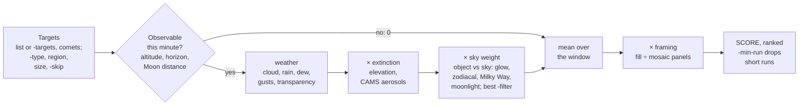

# astro-recommender


[](https://github.com/dkorunic/astro-recommender/releases/latest)
[](go.mod)
[](LICENSE)
[](https://github.com/dkorunic/astro-recommender/actions/workflows/pages.yml)
[](https://astrorecommender.org/)

A single-binary Go CLI that tells you what to image **tonight** from a given location. It ranks deep sky objects and bright comets over the whole astronomical night, from dusk to dawn (Sun below −18°), by how long each one stands high enough, far enough from the Moon and above your local horizon, and by how good the sky is while it does: the hourly cloud, transparency, dew and wind forecast, scattered moonlight, light pollution and atmospheric extinction all weigh in, minute by minute. The catalogues (about 44,000 entries in 34 lists, some 32,000 distinct objects) and the time-zone data are built in, no API keys are needed, and the astronomy is hand-rolled and checked against IAU SOFA. It also runs [in the browser](https://astrorecommender.org/), nothing to install.

It started as a port of the deep sky part of [uptonight](https://github.com/mawinkler/uptonight) and adds, among other things:

- **framing** for the **Celestron Origin** smart telescope (`-origin`) or any telescope and camera (`-fov`/`-scale`, or `-focal` with `-sensor`/`-pixel`): only objects that fit the frame and are large enough in pixels, scored by how well they fill it
- a sky-brightness model that weights every target by moonlight and light pollution, with optional `-filter` support (dual-, tri- or quad-band, Hα, [O III] or [S II] nebula filters, and the CLS and L-Pro broadband light-pollution filters) that scores each target by the light each filter passes
- weather folded into the score, not just shown
- comets from the Minor Planet Center, a **night plan** (`-plan`) with one target per time block, a measured local horizon (`-horizon`) and many more catalogues


## Contents

- [Features](#features)
- [Install](#install)
- [In the browser](#in-the-browser)
- [Usage](#usage)
  - [Examples](#examples)
  - [Flags](#flags)
  - [Filters](#filters)
  - [Target lists](#target-lists)
  - [Comets](#comets)
  - [Night plan](#night-plan)
  - [Local horizon](#local-horizon)
- [How objects are ranked](#how-objects-are-ranked)
  - [Accuracy](#accuracy)
  - [Formulas and references](#formulas-and-references)
- [Comparison with other tools](#comparison-with-other-tools)
- [Privacy](#privacy)
- [Credits](#credits)

## Features

- **Tonight's window**: astronomical dusk to dawn (Sun below −18°; `-twilight nautical` uses −12° for bright targets and short summer nights), found by searching from the site's own solar noon so time zones and polar nights can't cut it short. A run during the night (after dusk, or after midnight) plans only the rest of it; `-date` plans another evening and `-from`/`-to` narrow the window. The header says when the Moon rises or sets within it.
- **Observability per minute**, following uptonight's rules: altitude between `-alt-min` and `-alt-max`, Moon separation of at least the illumination percentage in degrees (skipped while the Moon is below the horizon), and optionally above your measured **local horizon** profile (`-horizon`). Each object's longest unbroken observable stretch is listed, and `-min-run 1h` drops those without one that long.
- **Choosing what to rank**: `-type` keeps only some object classes (galaxy, cluster, nebula, emission, comet, other; `-type emission` is what the line filters help), `-ra`/`-dec` with `-tol` only one region of the sky, `-size-min`/`-size-max` a range of sizes, and `-n` sets how many are listed.
- **Ranking** by an imaging score that sums, over every observable minute, the forecast sky quality × atmospheric extinction × a sky weight that sets the object's own surface brightness against the sky's, so a bright-surface object shrugs off moonlight and light pollution that a faint smudge does not, with uptonight's observable fraction (FOTO) shown alongside. Mean altitude breaks ties.
- **Sky brightness and moonlight**: the Krisciunas & Schaefer model of the moonless sky from `-bortle`, a measured `-sqm` value or, with a key (always in the browser), the site's modelled brightness looked up on DarkSkySites, brightened towards the horizon, with the zodiacal and galactic light of the target's own direction (half a magnitude brighter along the ecliptic than at its poles, up to 1.7 brighter in the Milky Way than at the galactic poles; from beyond the atmosphere, so only dimmed by it), plus moonlight scattered by air molecules and aerosols (Winkler's 2022 single-scattering model, which corrects K&S's dimming of the Moon's beam) from the Moon's phase, altitude and distance to the target. Targets are weighted by sky-limited signal-to-noise.
- **Target-type sensitivity to sky glow**: clusters count half of it. With `-filter dual|tri|quad|ha|oiii|sii`, emission-line targets (emission and planetary nebulae, supernova remnants, Wolf-Rayet nebulae, plus known mislabelled ones) are scored through the filter: the share of their light in its bands (Hα for H II regions, [O III] for planetaries, more [S II] for remnants) against the share of the sky it passes, where moonlight, being blue, gets through an [O III] band three times as much as an Hα one. That also relaxes their Moon-distance limit, most for Hα. Give the filters you own as a list (`-filter dual,ha,oiii`) and each target is scored with each; the FILTER column shows the one that scores it best. The broadband light-pollution filters `cls` (Astronomik CLS) and `lpro` (Optolong L-Pro) apply to every target, but with the sky glow taken as white LEDs they cut a galaxy's or cluster's light as much as the sky and never win there; on nebulae they beat no filter and lose to the line filters.
- **Extinction per hour** from the site's elevation and the CAMS aerosol forecast (dust, smoke, haze), or a fixed `-extinction`; shown in the forecast table.
- **Weather**: Open-Meteo cloud cover by layer (thin high cloud counts half), rain, dew-point spread and wind gusts, and 7Timer transparency and seeing (with a seeing estimate from the ECMWF upper-air profile, calibrated against ESO's DIMM seeing at Paranal and La Silla, for hours 7Timer does not cover), in an hourly table and folded into the score minute by minute. Hours a forecast does not cover get the covered hours' mean; a source missing entirely counts as perfect sky. Both warn, never silently.
- **Framing for the Celestron Origin** (`-origin`) or any telescope (`-fov`/`-scale`, or `-focal` with `-sensor`/`-pixel`): keeps only objects that fit the frame's short side and are at least `-min-px` across, scores how well they fill it, and shows their size in pixels. `-mosaic 4` also keeps objects too large for one frame, on the grid of up to that many panels that frames them best, with the score shared among the panels; `-rotate` (a camera you can turn, not the Origin) lays the major axis along the long side, so the minor axis known for about 12,400 objects counts.
- **Comets** from the Minor Planet Center's daily elements, cached locally: two-body positions every minute (elliptic, parabolic and hyperbolic orbits), kept when brighter than `-comet-mag`, ranked like any other target.
- **Night plan** (`-plan 2h`): one target per time block, chosen by a greedy pass followed by a local search that swaps and moves targets between blocks.
- **Thirty-four built-in target lists** (about 44,000 entries, some 32,000 distinct objects since the lists overlap: Gary Imm's selection and full Compendium, Messier, Caldwell, Herschel 400, Pensack 500, NGC, IC, LBN, LDN, Barnard, Sharpless, RCW, Gum, Cederblad, cometary globules, van den Bergh and van den Bergh & Herbst reflection nebulae, Arp, Hickson compact groups, Abell galaxy clusters, Arp-Madore southern peculiar galaxies, MWSC, Dias open clusters, Harris globular clusters, Melotte, Collinder, Magakian's reflection nebulae, Hartley's southern dark clouds, the Magellanic Clouds' Henize and DEM nebulae, Green's supernova remnants and two planetary nebula databases) or your own uptonight-format YAML, with every object's constellation computed from the IAU boundaries; a `-skip` file leaves out the ones you have already imaged.
- **Location handling**: offline IANA time-zone lookup from the coordinates, reverse geocoding of the site name, coordinates rounded to about 1 km before any request, and a fully offline mode.
- **Terminal output**: aligned, colour-coded tables with a legend; honours `NO_COLOR`, `CLICOLOR_FORCE` and `TERM=dumb`. Text from the network or from target files is stripped of control characters so it cannot inject terminal escape sequences. `-json` prints the same report as one JSON document for scripts, and `-csv` the targets in the CSV format N.I.N.A. imports.
- **In the browser** at [astrorecommender.org](https://astrorecommender.org/): the same program compiled to WebAssembly, every flag a form field, uploaded `-targets`/`-horizon`/`-skip` files, shareable links that fill and run the form, and each result linked to Aladin Lite, with a DSS2 thumbnail and the object's altitude curve on hover; light, dark and red night-vision themes.
- **Verified astronomy**: the hand-rolled Sun, Moon, sidereal-time, precession, altitude and azimuth, ecliptic and galactic-coordinate formulas, the Moon's distance and phase, and dusk and dawn are checked against IAU SOFA's current release in the test suite, which also pins SOFA's own reference results (see [Accuracy](#accuracy)); a single static binary with no API keys.

## Install

Download a prebuilt binary for Linux, macOS or Windows from the [Releases](https://github.com/dkorunic/astro-recommender/releases) page.

Or with Go:

```sh
go install github.com/dkorunic/astro-recommender@latest
```

On macOS or Linux, Homebrew users can install it from the tap:

```sh
brew tap dkorunic/tap
brew install astro-recommender
```

On macOS the tap also has it as a cask:

```sh
brew install --cask dkorunic/tap/astro-recommender
```

Or from a checkout, using [Task](https://taskfile.dev/):

```sh
task build   # formats, then builds a static, PGO-optimised binary (profile: default.pgo)
task pgo     # regenerates default.pgo from the offline scoring benchmark
task test
task lint    # golangci-lint
```

Plain `go build .` works too.

It needs Go 1.27+. The target catalogues are built into the binary.

## In the browser

The same program runs at **https://astrorecommender.org/**, compiled to WebAssembly, with every flag as a form field. Nothing to install: the ranking runs in your browser, and your coordinates go only to the same forecast, geocoding and comet services the command line calls (7Timer and DarkSkySites through a small Cloudflare Worker, since they do not allow browser requests; it caches the answers per rounded coordinate and holds the DarkSkySites key).

What works there:

- every flag, built from the program's own `-h`; fields left empty keep their defaults
- `-targets`, `-horizon` and `-skip` take an uploaded file
- "Use my location" asks the browser for your position, and the location's time zone shows in the empty `-tz` field
- the address bar carries the form after each run (files excepted), so the URL can be bookmarked or shared (the Copy link button copies it); opening such a link fills the form and runs it
- weather, transparency and seeing, aerosols, geocoding and comets, as on the command line
- the DarkSkySites sky-brightness lookup, without a key of your own (the page's key is shared; `-no-sqm` skips it)
- every result's name links to [Aladin Lite](https://aladin.cds.unistra.fr/AladinLite/) at its position, and pointing at it shows a DSS2 colour thumbnail from CDS and, under it, the object's altitude through the window: the `-alt-min`–`-alt-max` band shaded, the curve bold where it lies within it, and its peak
- the form is remembered by the browser between visits, and the Reset button clears it back to the defaults
- light or dark theme following the browser, with a Theme button to override it, which also offers a red night-vision theme (dim red on black, the colour codes turned into brightness) that keeps your eyes dark-adapted at the telescope (remembered by the browser)

What does not:

- caching: the comet elements are downloaded on every run instead of being kept for a day

## Usage

```sh
astro-recommender -lat 45.815 -lon 15.982 -origin -filter dual -bortle 6 -n 5 -date 2026-10-13
```

```
Location: 45.8150, 15.9820 (Mjesni odbor Zrinjevac, Gradska četvrt Donji grad, Zagreb, Grad Zagreb, Hrvatska), Europe/Zagreb
Window:   2026-10-13 19:53 - 2026-10-14 05:33 (9h40m0s)
Moon:     11% illuminated, min separation 11°, never up
Size:     4.1' - 44.7'
Targets:  GaryImm, 1 comets brighter than mag 12.0
Frame:    1.32° x 0.75°, 1.23"/px (3856 x 2180 px)
Sky:      Bortle 6 (zenith 18.80 mag/arcsec²), extinction 0.23-0.24 (elevation 126 m, aerosols) mag/airmass, filter dual 7 nm

HOUR   CLOUD  LOW/MID/HIGH  TRANSP  EXT   SEEING   DEW SPREAD  WIND/GUST
19:00  11%    0/11/0%       2/8     0.23  1.5-2"   6.4°C       4/9 km/h
20:00  0%     0/0/0%        2/8     0.24  1.5-2"   5.0°C       4/10 km/h
21:00  0%     0/0/0%        2/8     0.24  1.5-2"   4.2°C       5/10 km/h
22:00  0%     0/0/0%        2/8     0.24  1.5-2"   4.2°C       5/11 km/h
23:00  0%     0/0/0%        2/8     0.24  1.5-2"   4.8°C       5/11 km/h
00:00  0%     0/0/0%        2/8     0.24  1.5-2"   5.1°C       5/9 km/h
01:00  0%     0/0/0%        2/8     0.23  1.5-2"   4.8°C       4/8 km/h
02:00  0%     0/0/0%        2/8     0.23  1.5-2"   4.3°C       4/8 km/h
03:00  4%     0/4/0%        2/8     0.23  1.5-2"   4.5°C       4/7 km/h
04:00  100%   0/100/1%      2/8     0.24  1-1.25"  5.1°C       3/6 km/h
05:00  82%    0/82/0%       2/8     0.24  1-1.25"  4.1°C       2/5 km/h

#  NAME      DESCRIPTION                  TYPE             CON  RA       DEC     SIZE  FOTO  SCORE  OBSERVABLE   MAX ALT      SKY   MAG  SB     FILTER  PX
1  NGC 7380  Wizard Nebula                Emission Nebula  Cep  22 47.4  +58 08  25'   0.98  0.43   19:53-05:24  78° @ 22:15  18.6  7.2  ~22.8  dual    1218
2  NGC 281   PacMan Nebula                Emission Nebula  Cas  00 52.9  +56 37  35'   1.00  0.38   19:53-05:33  79° @ 00:21  18.7  -    -      dual    1705
3  IC 63     Gamma Cassiopeia Nebula      Emission Nebula  Cas  00 59.5  +60 55  20'   1.00  0.38   19:53-05:33  75° @ 00:27  18.7  -    -      dual    974
4  Sh2-173   Phantom of the Opera Nebula  Emission Nebula  Cas  00 21.3  +61 44  25'   1.00  0.38   19:53-05:33  74° @ 23:49  18.7  -    -      dual    1218
5  NGC 7635  Bubble Nebula                Emission Nebula  Cas  23 20.8  +61 13  15'   1.00  0.38   19:53-05:33  74° @ 22:48  18.6  -    -      dual    731
```

The output ends with a legend explaining every column of the tables shown and the colours. In short:

- **RA**, **DEC**: the J2000 position as `hh mm.m` and `±dd mm`; comets show where they are mid-window.
- **FOTO**: the fraction of the window during which the object meets the altitude, horizon and Moon-distance limits (uptonight's metric).
- **SCORE**: imaging quality from 0 to 1, where 1 means a perfect minute for the whole window under a pristine dark sky. It accounts for weather, extinction, sky brightness and, with framing, how well the object fits the frame. This column decides the order.
- **OBSERVABLE**: the longest stretch during which the object meets the limits without a break; a trailing `+` means there are other, shorter stretches (the Moon rising, a tree in the horizon profile, a pass through the zenith above `-alt-max`). `-min-run` filters on this length.
- **MAX ALT**: the object's highest altitude in the window, and when it occurs.
- **SKY**: the average sky brightness at the object while it is observable, in V mag/arcsec², with the zodiacal and galactic light of its direction. Higher is darker: about 22 is pristine and 18–19 is a suburb or a bright Moon. The filter isn't included.
- **SB**: the object's own surface brightness in the same units, which the score sets against the sky the object sees: SKY, cut by `-filter` to its bands' share when that scores better than without it (emission-line objects; a broadband filter never helps continuum) or halved for star clusters without nebulosity, whose own surface brightness is then not used. `~` marks an estimate (derived from the magnitude and size, or a B value moved to V by a typical colour) rather than a measurement, `-` an object with no brightness data, which is scored as if far fainter than the sky.
- **SIZE**: the major axis in arcminutes; with `-rotate`, `major x minor` where the minor axis is known.
- **MAG**: the integrated V magnitude from the catalogue; a trailing `B` marks a B magnitude where no V is known, and a comet shows its estimated magnitude mid-window. `-` when unknown. Scoring uses it only through the derived surface brightness (SB).
- **CON**: the IAU constellation abbreviation (JSON keeps the full name).
- **PX**: the object's size in pixels at the frame's pixel scale, shown only with framing (`-origin`, `-fov`, `-scale`, `-focal`), since without it there is no frame to measure against. With `-mosaic`, a grid such as `2x1` (columns along the frame's long side × rows) follows when more than one panel scores best.

On a colour-capable terminal the output is colour-coded green/yellow/red. Colours are turned off when output is piped, when `NO_COLOR` is set or when `TERM=dumb`. `CLICOLOR_FORCE=1` turns them on regardless.

`-json` replaces the tables with one JSON document holding the same report: `location`, `window` (RFC 3339 times in `-tz`), `moon` (illumination 0–1 and when it is up), `sky`, `frame` (with framing), `forecast` per hour (its `seeing` is 7Timer's range and `seeingArcsec` the upper-air estimate, which replaced the `seeingClass` of versions up to 0.9), `plan` (with `-plan`) and `targets` (RA/Dec in J2000 degrees, size and `minor` axis in arcminutes, `mag` and `bmag` (V and B magnitudes), `surfaceBrightness` in mag/arcsec² with `surfaceBrightnessEstimated` for the `~` values, `frame` as the framing factor, `observable` as the longest run and the number of runs, `mosaic` as `cols` and `rows` when more than one panel scored best; `frame` adds `maxPanels` and `rotate` when set). Unknown values are left out rather than written as null. A night with nothing to plan (no night at that twilight, or a window already past) gives `{"message": "…", "targets": []}`. Warnings still go to stderr.

`-csv` replaces the tables with the targets as CSV in Telescopius's observing-list format, which [N.I.N.A.](https://nighttime-imaging.eu/)'s simple sequencer imports (Sequencer → Import targets): `Catalogue Entry` (the name), an empty `Familiar Name` and the J2000 position to the second; a comet's is its mid-window position, moved back from the equinox of date the RA/DEC columns use to J2000, since N.I.N.A. slews to it. It lists the top `-n`, or with `-plan` the planned targets in plan order, each once. A night with nothing to plan prints the header alone, the message on stderr. N.I.N.A. sets each target's position angle to 0, and a mosaic is laid out in its Framing Assistant.

```sh
astro-recommender -lat 45.815 -lon 15.982 -origin -plan 2h -csv > tonight.csv
```

### Examples

**Only the location is required.** This ranks Gary Imm's top targets for tonight under a dark sky, with tonight's weather, the comets brighter than magnitude 12 and **no framing, so SIZE is the catalogue size and there is no PX column**:

```sh
astro-recommender -lat 45.815 -lon 15.982
```

The same from a suburban garden with the Celestron Origin and a dual-band filter. **`-origin` keeps only objects that fit the 1.32° × 0.75° frame and are at least 200 px across, and scores how well they fill it**; `-bortle 6` brightens the sky model, which **`-filter` then discounts for emission nebulae and supernova remnants**, so they climb above galaxies and reflection nebulae:

```sh
astro-recommender -lat 45.815 -lon 15.982 -origin -filter dual -bortle 6
```

**A measured sky instead of a Bortle guess.** `-sqm` takes the zenith reading of an SQM meter or the *World Atlas 2015* value from lightpollutionmap.info and is more precise than the class; the header shows the Bortle class it corresponds to:

```sh
astro-recommender -lat 45.815 -lon 15.982 -origin -sqm 20.4
```

Planning ahead. **`-date` picks the evening, and `-from`/`-to` narrow the window to the hours you will actually be out**; the window is still clamped to astronomical night, so `-to 06:00` never extends into twilight. Open-Meteo covers about two weeks ahead and 7Timer only three days, so **a run for next weekend warns that the transparency forecast does not cover the window** and scores on weather alone:

```sh
astro-recommender -lat 45.815 -lon 15.982 -origin -date 2026-10-10 -from 22:00 -to 02:00
```

A schedule for the night. **`-plan 2h` adds a table with one target per 2-hour block** (plus a shorter last block), picked greedily and then improved by swapping until no change helps. **The planner considers every ranked target, not just the `-n` printed**:

```sh
astro-recommender -lat 45.815 -lon 15.982 -origin -filter dual -plan 2h
```

Another telescope and camera. **`-focal`, `-sensor` and `-pixel` describe the setup and replace the Origin's frame**: here a 400 mm refractor with an APS-C sensor (23.5 × 15.6 mm, 3.76 µm pixels) gives a 3.37° × 2.23° field at 1.94″/px. **The header's `Frame:` line shows the result**; check it when the numbers look surprising:

```sh
astro-recommender -lat 45.815 -lon 15.982 -focal 400 -sensor 23.5x15.6 -pixel 3.76 -filter dual
```

**Large objects as mosaics.** `-mosaic 6` keeps objects that fit a grid of up to six frames (3 × 2, 1 × 6 and so on) overlapping by 10%, each scored on the grid that frames it best with the score divided among the panels, so a 2-panel mosaic scores like a single frame of half the quality. With a rotatable camera, `-rotate` frames the major axis along the long side, so an edge-on galaxy or the Veil fits where a disc of the same length would not:

```sh
astro-recommender -lat 45.815 -lon 15.982 -focal 400 -sensor 23.5x15.6 -pixel 3.76 -mosaic 6 -rotate
```

**If you already know the field and scale, give them directly.** `-fov` is in degrees, so a wide 10° × 7° lens field is `-fov 10x7`; **`-min-px 50` lowers the size floor** so that objects of a few arcminutes still count at the coarser scale:

```sh
astro-recommender -lat 45.815 -lon 15.982 -fov 10x7 -scale 6 -min-px 50
```

A different catalogue. **`-list` picks one of the built-in lists**; two thirds of the LDN dark nebulae are under the 10′ default and 8 have no size at all, so **`-size-min 0` keeps them instead of dropping them**:

```sh
astro-recommender -lat 45.815 -lon 15.982 -list LDN -size-min 0
```

One region of the sky. **`-ra` and/or `-dec` keep only objects within `-tol` degrees** (default 10, above 0) of the given J2000 coordinates, decimal or sexagesimal; RA counts 15° per hour and wraps at 24h. **Either alone also works**, e.g. `-dec 60` for a band around +60°:

```sh
astro-recommender -lat 45.815 -lon 15.982 -list OpenNGC -size-min 0 -ra "20 30" -dec 40 -tol 15
```

**Planetary nebulae are small, so the Origin's default 200 px floor would leave almost nothing**: `-min-px 30` admits the ones at least 30 px across, and `-filter dual` scores them through the filter, mostly on their [O III] light:

```sh
astro-recommender -lat 45.815 -lon 15.982 -origin -filter dual -list HASH -min-px 30 -n 30
```

Your own targets. **`-targets` takes any uptonight-format YAML**, such as a hand-written shortlist, **and overrides `-list`**:

```sh
astro-recommender -lat 45.815 -lon 15.982 -origin -targets my-targets.yaml
```

A site with obstructions. **`-horizon` adds your measured horizon** (file format below) on top of the altitude floor, so a target behind the neighbour's house doesn't count while it is there; **it can only raise the floor, so `-alt-min 20` is what lets the unobstructed directions start below the default 30°**:

```sh
astro-recommender -lat 45.815 -lon 15.982 -origin -horizon horizon.txt -alt-min 20
```

Comets only when they are worth it. **`-comet-mag 8` adds just the naked-eye and binocular comets, and `-no-comets` skips the MPC download entirely**:

```sh
astro-recommender -lat 45.815 -lon 15.982 -comet-mag 8
astro-recommender -lat 45.815 -lon 15.982 -no-comets
```

A remote or future site. **The time zone is looked up from the coordinates, so planning a trip needs no `-tz`**; give one only to see the times in another zone. Here Namibia's winter sky from Zagreb, in local Namibian time, under a pristine sky, **with the fixed extinction of a high dry site**:

```sh
astro-recommender -lat -23.3 -lon 16.3 -date 2026-06-15 -bortle 1 -extinction 0.15
```

Fully offline. **The four `-no-*` flags skip every network source**; the sky is then perfect, extinction is the `-extinction` value (0.2 by default) and **the run is deterministic**, which suits scripts and tests:

```sh
astro-recommender -lat 45.815 -lon 15.982 -no-weather -no-geocode -no-sqm -no-comets
```

### Flags

| Flag | Default | Description |
|------|---------|-------------|
| `-lat`, `-lon` | required | Location in degrees, north and east positive |
| `-tz` | from location | IANA time zone used for all displayed times. By default it's looked up offline from `-lat`/`-lon`, falling back to the system zone |
| `-date` | tonight | Evening to plan, `YYYY-MM-DD`. Without it, a run during the night (after dusk, or after midnight) plans only the rest of the night in progress |
| `-from`, `-to` | dusk, dawn | Imaging window in local `HH:MM`, e.g. `-from 22:00 -to 02:00`. Times before noon mean the next morning. A time repeated on the night clocks fall back is read as the wider window (`-from` the first, `-to` the second). Always clamped to the night as `-twilight` defines it |
| `-twilight` | `astronomical` | What counts as night: `astronomical` (Sun below −18°) or `nautical` (below −12°), which starts earlier and ends later, for bright clusters and planetaries or short summer nights that never reach full darkness |
| `-n` | `20` | Number of objects to list |
| `-plan` | `0` (off) | Print a night plan with one target per block of this length, e.g. `2h` |
| `-min-run` | `0` (any) | Keep only objects observable without a break for at least this long, e.g. `1h`: FOTO counts every observable minute, this needs them in one stretch (the OBSERVABLE column) |
| `-json` | off | Print the report as one JSON document instead of the tables |
| `-csv` | off | Print the targets (with `-plan`, the planned ones in order) as CSV that N.I.N.A. imports, instead of the tables; not with `-json` |
| `-horizon` | none | Local horizon file (see below) |
| `-origin` | off | Framing for the Celestron Origin (IMX678, 3856 × 2180 px of 2.0 µm at 335 mm: 1.32° × 0.75°, 1.23″/px): keep only objects that fit the frame and are at least `-min-px` across, and score how well they fill it |
| `-fov`, `-scale` | Origin | Framing for another telescope: field of view `WxH` in degrees up to 180 (e.g. `2.5x1.7`) and pixel scale in ″/px between 0.01 and 1000. Either one turns framing on; the one you leave out uses the Origin's value. When both are given, a frame of more than 20,000 px across is rejected, which catches a field typed in arcminutes or a scale from another camera; with only one of them set there is nothing to compare and a field typed in arcminutes goes unnoticed, so check the `Frame:` line in the header |
| `-focal`, `-sensor`, `-pixel` | off | Describe the camera instead: focal length in mm, sensor size `WxH` in mm and pixel size in µm (e.g. `-focal 400 -sensor 23.5x15.6 -pixel 3.76`). `-sensor` sets the field of view (`2·atan(side / 2·focal)` per side) in place of `-fov`; `-pixel` sets the pixel scale (`206.265 · pixel / focal`) in place of `-scale`. Both need `-focal`, `-focal` needs at least one of them, and the pair they replace cannot be given with them. The 20,000 px check applies whenever both the field and the scale are given, by either route |
| `-min-px` | `200` | With framing: minimum object size in pixels (≈4.1′ on the Origin); must be 0 or more even when framing is off |
| `-mosaic` | `1` | With framing: most mosaic panels per object, 1–25. Every grid of at most that many frames, overlapping by 10%, is tried and the one with the best fill divided by its panel count kept, since the night's time is shared among the panels; objects too large for one frame then stay in the list |
| `-rotate` | off | With framing: the camera can be rotated, so the major axis lies along the frame's long side and a known minor axis across (about 12,200 objects: OpenNGC's, carried to the lists built on it, and Lynds' for LBN; nebula axes are rough). Without it the orientation is unknown and the major axis must fit the short side. Not the Origin, whose camera cannot turn |
| `-filter` | none | Nebula filters you own for emission-line targets, comma-separated: `dual` (Hα and [O III] at once, as on a colour camera), `tri` (plus Hβ), `quad` (plus Hβ and [S II]), `ha`, `oiii`, `sii`; and broadband light-pollution filters for any target: `cls` (Astronomik CLS, 450–520 and 640–690 nm; Optolong CLS and IDAS LPS-D2 are close) and `lpro` (Optolong L-Pro; IDAS LPS-D1/P2/D3 and Baader Moon & Skyglow alike). Each target is scored with each filter, every minute taking the better of the filter and none, and keeps the best; the FILTER column (and JSON `filter`, in targets and plan blocks) names it, `-` when no filter beats none. A target no filter helps is scored without one, exactly as with no `-filter`; six line filters cost about twice one, and a broadband one more, since it scores every target rather than only the emission-line ones. Every line filter band is `-filter-nm` wide, so a filter with one wide band (L-eNhance) is approximated, and `tri`/`quad` score close to `dual`: their gain is colour, which the score does not measure |
| `-filter-nm` | `7` | With a line filter in `-filter`, each line filter band's width in nm, 1–30 (3 nm for narrow mono filters, 10–12 nm for wide dual-band ones); an error with only `cls`/`lpro`, whose passbands are fixed |
| `-bortle` | `0` (dark) | Bortle class (1–9) of the site, which sets its zenith sky brightness |
| `-sqm` | unset | Measured zenith sky brightness in mag/arcsec², from an SQM meter or the *World Atlas 2015* layer on [lightpollutionmap.info](https://www.lightpollutionmap.info). More precise than `-bortle`, which it overrides; the header shows the matching Bortle class. When neither is given and `DARKSKYSITES_API_KEY` is set, it is looked up on [DarkSkySites](https://www.darkskysites.com/api-access); a free API key can be requested at [darkskysites.com](https://www.darkskysites.com/api-access#apply) |
| `-extinction` | auto | Atmospheric extinction in magnitudes per airmass. By default it is estimated per hour from the site's elevation and the CAMS aerosol forecast. Setting it fixes the value; `0.2` is used when no estimate is available |
| `-alt-min`, `-alt-max` | `30`, `80` | Altitude limits in degrees |
| `-size-min`, `-size-max` | `10`, `300` | Object size limits in arcminutes, 0 or more; `-size-min 0` means no minimum. Framing replaces them with `-min-px` × scale up to the frame's short side (4.1′–44.7′ on the Origin), since the size is the major axis and its orientation in the frame is unknown, unless you set them explicitly; with `-mosaic` the limit is the largest grid's short side, with `-rotate` its long side (for an object with a known minor axis; a round or unmeasured one still has to fit the short side). A `-size-max` above that limit is an error, because such objects cannot be framed |
| `-ra`, `-dec` | | Keep only objects near this J2000 right ascension (hours, `20.5` or `"20 30 00"`) and/or declination (degrees, `-12.5` or `"-12 30 00"`); comets use their mid-window position of date, within 0.4° of J2000 |
| `-tol` | `10` | With `-ra`/`-dec`, how near in degrees on each axis, above 0 and at most 180; RA counts 15° per hour and wraps at 24h |
| `-list` | `GaryImm` | Built-in target list (see below) |
| `-targets` | none | Your own uptonight-format targets YAML file; overrides `-list` |
| `-skip` | none | A file of names to leave out, one per line with `#` comments, e.g. the objects you have already imaged. Case and spaces do not matter (`ngc7789` is `NGC 7789`); comets can be named too |
| `-type` | all | Keep only these object classes, comma-separated: `galaxy` (galaxy groups too), `cluster`, `nebula` (a cluster with nebulosity counts as both), `emission` (the emission-line objects the line filters help), `comet` and `other` (stars, asterisms). Comets are not fetched unless `comet` is among them, and `-type comet` with `-no-comets` is an error |
| `-comet-mag` | `12` | Include comets brighter than this total visual magnitude |
| `-no-comets` | off | Skip comets |
| `-no-weather` | off | Skip the Open-Meteo and 7Timer forecasts |
| `-no-geocode` | off | Skip the reverse geocoding of the location |
| `-no-sqm` | off | Skip the DarkSkySites sky brightness lookup |
| `-version` | | Print the version, commit and build time, then exit |

### Filters

The `-filter` choices are classes rather than products: filters of the same class score alike. Some popular filters and the choice that matches each:

| `-filter` | Passes | Popular filters | `-filter-nm` |
|---|---|---|---|
| `ha` | Hα | Narrowband Hα from Astronomik, Baader, Antlia, Chroma, Optolong | 3–7 |
| `oiii` | [O III] | Narrowband [O III] from the same makers | 3–7 |
| `sii` | [S II] | Narrowband [S II] from the same makers | 3–7 |
| `dual` | Hα + [O III] | Optolong L-eXtreme (7 nm), L-Ultimate (3 nm); Antlia ALP-T (5 nm); ZWO Duo-Band; STC Astro Duo-NB | the filter's band width |
| `tri` | Hα + Hβ + [O III] | Optolong L-eNhance (one 24 nm band over Hβ and [O III], 10 nm Hα) | 10–12, an approximation |
| `quad` | Hα + Hβ + [O III] + [S II] | Optolong L-Quad Enhance; Radian Triad Ultra | the filter's band width |
| `cls` | 450–520 + 640–690 nm | Astronomik CLS / CLS-CCD; Optolong CLS / CLS-CCD; close: IDAS LPS-D2 | — |
| `lpro` | 400–700 nm with the lamp lines notched | Optolong L-Pro; IDAS LPS-D1, LPS-P2, LPS-D3; milder: Baader Moon & Skyglow | — |
| none | 400–700 nm | Luminance and UV/IR-cut filters (Astronomik L-2/L-3, Baader UV/IR Cut), RGB sets: leave `-filter` out | — |

`-filter-nm` is one width for every line filter given, so list the filters of similar band width together. The broadband choices model the sky glow as white LEDs, under which they help only emission nebulae ([MODELS.md](MODELS.md#broadband-filters)).

### Target lists

All eight [uptonight target lists](https://github.com/mawinkler/uptonight/tree/main/targets) are built in, plus the full Gary Imm compendium, the Milky Way Star Clusters catalogue, the Melotte and Collinder catalogues, the Planetary Nebulae.net discoveries, the HASH planetary nebula database, the Sharpless catalogue of H II regions, the Caldwell catalogue, the RCW catalogue of southern Hα regions, Green's supernova remnants, Barnard's dark nebulae, van den Bergh's and van den Bergh & Herbst's reflection nebulae, Arp's peculiar galaxies, Hickson's compact groups, Gum's southern H II regions, Cederblad's bright nebulae, the cometary globules, the Abell galaxy clusters, Magakian's merged reflection nebulae, the Henize and DEM nebulae of the Magellanic Clouds, Harris' globular clusters, Dias' open clusters, Hartley's southern dark clouds and Arp & Madore's southern peculiar galaxies. Pick one with `-list`; names aren't case-sensitive:

| List | Objects | Contents |
|------|---------|----------|
| `GaryImm` (default) | 206 | Gary Imm's top astrophotography targets plus the top of his Deep Sky Compendium; sizes and positions checked against the 2026 (6th) edition |
| `GaryImmFull` | 3145 | All objects of Gary Imm's Deep Sky Compendium (2026, 6th edition), including his 0–5 rating (see below) |
| `Messier` | 110 | The Messier catalogue |
| `Herschel400` | 400 | The Astronomical League's Herschel 400 |
| `Pensack500` | 502 | Don Pensack's 500 best deep sky objects |
| `OpenNGC` | 8373 | The NGC, from [OpenNGC](https://github.com/mattiaverga/OpenNGC): V and B magnitudes, B-band surface brightness (`bsurfbr`) and minor axis (`minor`) where known, Messier number, NGC/IC cross-identifications and common names in the description |
| `OpenIC` | 5590 | The IC, from OpenNGC, described like `OpenNGC` |
| `LBN` | 1116 | Lynds' Catalogue of Bright Nebulae, with the minor axis from Lynds' smallest dimension; typed by Lynds' colour on the Palomar plates: reflection nebula when brighter on the blue plate, nebula when equal, H II region when brighter on (or only on) the red |
| `LDN` | 1764 | Lynds' Catalogue of Dark Nebulae; the size is the diameter of a disc of Lynds' area (he gives no axes), a lower bound for an elongated cloud |
| `MWSC` | 3006 | Milky Way Star Clusters (Kharchenko et al. 2013): open and globular clusters, associations and moving groups (typed `Open Cluster`, noted in the description); size is the diameter of the central part (r1); the 56 Messier clusters carry their M number and common name |
| `Melotte` | 245 | Melotte's 1915 catalogue of star clusters, named `Mel N` with the NGC/IC number, Messier number and common name in the description |
| `Collinder` | 471 | Collinder's 1931 catalogue of open clusters, named `Cr N`, described like `Melotte` |
| `PNnet` | 1016 | Planetary nebulae found by the [Planetary Nebulae.net](https://planetarynebulae.net/) amateur group: 355 true, likely and possible PNe and 661 candidates, status and PN G designation in the description |
| `HASH` | 3994 | Galactic planetary nebulae from the [HASH PN database](https://hashpn.space/) (true, likely and possible), status, PN G designation and morphology in the description; size is the largest measured major diameter; V magnitude from Gary Imm's Compendium for the planetaries it lists |
| `Sharpless` | 313 | Sharpless' 1959 catalogue of H II regions, named `Sh2-N`; position, size, type, magnitude and common name from Gary Imm's Compendium where it lists the object, else Sharpless' own position and diameter |
| `RCW` | 181 | Rodgers, Campbell & Whiteoak's 1960 catalogue of southern Hα emission regions, named `RCW N`; NGC/IC/Gum cross-identifications in the description; position, size, type, magnitude and common name from Gary Imm's Compendium where it lists the region itself, else RCW's own position and axes |
| `SNR` | 98 | The optically detected supernova remnants of Green's 2024 catalogue, named `SNR Glll.l±bb.b`; Green's position and axes, other names and the Compendium's parts (the Cygnus Loop's NGC 6960, NGC 6992, ...) in the description, magnitude and common name from the Compendium |
| `Caldwell` | 109 | Patrick Moore's Caldwell catalogue, named `C N`; position, size, type, magnitude and common names from Gary Imm's Compendium, C 24 (NGC 1275) and C 35 (NGC 4889) from OpenNGC; Caldwell's own designation in the description where the Compendium row is a larger complex (C 68, C 82) or a pair (C 14, C 60) |
| `Barnard` | 349 | Barnard's 1927 catalogue of dark nebulae, named `Barnard N` (numbered to 370, with gaps and six lettered parts); position, size and common name from Gary Imm's Compendium where it lists the object (all but two), else Barnard's own |
| `vdB` | 158 | Van den Bergh's 1966 catalogue of reflection nebulae, named `vdB N`; the illuminating star and NGC/IC cross-identifications in the description; position, size, type and common name from the Compendium where it lists the object, else the catalogue's (the star's position, twice its largest radius) |
| `vdBH` | 136 | Van den Bergh & Herbst's 1975 southern reflection nebulae, named `vdBH N` with a, b... for the parts of a number; the catalogue's position and largest diameter (34 have none) |
| `Arp` | 338 | Arp's 1966 Atlas of Peculiar Galaxies, named `Arp N`; the member galaxies in the description; position, size, type, magnitude, surface brightness and common name from the Compendium, the minor axis from OpenNGC for single galaxies |
| `HCG` | 100 | Hickson's 1982 compact groups of galaxies, named `HCG N`; the group's position, diameter and total B magnitude (`bmag`), with the Compendium's common name and cross-identifications |
| `Ced` | 330 | Cederblad's 1946 catalogue of bright diffuse nebulae, named `Ced N` with a, b... for parts; typed emission (an emission spectrum, cluster or not: Ced 7 is IC 1805), reflection, or cluster nebulosity (a continuous spectrum around a cluster: the Pleiades' parts); Cederblad's position and largest dimension (122 have none), NGC/IC name in the description, and type, size, magnitude and common name from the Compendium where it lists the nebula |
| `Gum` | 96 | Gum's 1955 southern H II regions, named `Gum N` with a, b... for parts; SIMBAD's position (SIMBAD gives few sizes) and its main identifier in the description, with type, size, magnitude and common name from the Compendium, which lists all 85 numbers; Gum 34 (no position anywhere) and Gum 12 (the 36° Gum Nebula, not a SIMBAD identifier) are left out |
| `CG` | 48 | Cometary globules (Hawarden & Brand 1976, Zealey et al. 1983, Reipurth 1983), named `CG N`, mostly in Vela and Puppis; SIMBAD's position and size (29 have none, so `-size-min 0` keeps them: most are a few arcminutes); typed `Dark Nebula` |
| `ACO` | 822 | Abell, Corwin & Olowin's 1989 rich clusters of galaxies with a measured redshift, named `ACO N` (`ACO S N` for the supplementary southern ones; not `Abell N`, which the lists use for Abell's planetary nebulae); the redshift in the description and the Abell radius 1.72′/z as the size, which matches the Compendium's sizes for the clusters it lists (Coma 74′ for its 64′); the Compendium's size, magnitude and common name where it has the cluster. Without surface brightness they rank by geometry and sky alone |
| `MCRN` | 913 | Magakian's 2003 merged catalogue of reflection nebulae, named `MCRN N`: every reflection nebula of DG, Racine, vdB, vdBH, Bernes, Cederblad, NGC/IC and the RNO/GM lists, with those designations in the description; typed by Magakian's class (`Emission Nebula` when it leads with E). Magakian gives no sizes, so only the 166 the Compendium lists by a cross-ID have one, with its position, type, magnitude and common name; `-size-min 0` keeps the rest |
| `Henize` | 372 | Henize's 1956 emission nebulae of the Large and Small Magellanic Clouds, named `LMC N44`, `SMC N66` (SIMBAD's `LHA 120-N 44`, `LHA 115-N 66`); the nebulae, remnants and nebulous clusters among SIMBAD's identifiers (its stars and planetaries left out, 24 parts without a position too); SIMBAD's position and size, else DEM's size and axes through DEM's Henize cross-IDs; the Compendium's size, type and common name for the five it lists |
| `DEM` | 525 | Davies, Elliott & Meaburn's 1976 Hα regions of the LMC (357, `DEM L N`) and SMC (168, `DEM S N`), with their axes and Henize cross-IDs; typed `HII Region` |
| `Harris` | 157 | Harris' 2010 edition of the Milky Way's globular clusters, named as Harris does (`NGC 104`, `Pal 5`, `Terzan 5`), integrated V magnitude and other name; size from the Compendium for the 92 it lists, else 7.7 half-light radii, the Compendium's median ratio (Harris has no visual extent; 4 clusters have neither) |
| `Dias` | 1963 | Dias et al.'s 2002 open clusters (version 3.5, 2016), with their apparent diameters from Dias' DSS inspection, an estimate independent of MWSC's (a median two-thirds of MWSC's r1 diameter for the 1608 clusters both name; NGC 2682: 25′ for 66′); asterisms, non-existent NGCs and dubious or unfound clusters left out, OB associations and moving groups noted; magnitude and common name from the Compendium, and a cluster named like the nebula it lies in (NGC 2264, NGC 6514) is a cluster with nebulosity |
| `DCld` | 1101 | Hartley et al.'s 1986 southern dark clouds, named `DCld lll.l±bb.b` (14 designations rebuilt from the position, where VizieR's lost the latitude's sign or tens), with both axes; typed `Dark Nebula` |
| `AM` | 5973 | Arp & Madore's 1987 southern peculiar galaxies and associations, named `AM hhmm-ddd`, one entry per designation (an association's members, listed separately, at their mean position and sized by their extent), with Arp & Madore's description; typed by their description codes: `Galaxy Group` for triples to quintets, chains, groups and clusters or three members, `Galaxy Duo` for doubles and pairs, 82 `Planetary Nebula` and 62 `Nebula` (stars with nebulosity), else `Galaxy`. Most are an arcminute or two, so framing drops them; without magnitudes they rank by geometry and sky alone |

`OpenNGC.yaml` and `OpenIC.yaml` are generated by `scripts/openngc2yaml.py` from the OpenNGC database (Python standard library only); names, types, positions and sizes follow uptonight's conversion, except that OpenNGC's coarse nebula types (`Neb` for the California Nebula, `Cl+N` for both NGC 1333's reflection nebula and Orion's H II regions) take the Compendium's emission or reflection call where it lists the object, and `mag` (V), `bmag` (B) and `bsurfbr` (mean B-band surface brightness within the 25 mag isophote, mag/arcsec²) are added where OpenNGC has them, and `minor`, the minor axis in arcminutes, where it is below the major one. Where OpenNGC has no V magnitude, `GaryImmFull.yaml`'s (also V) is used, and its V-band surface brightness is added as `surfbr`, so regenerate `GaryImmFull.yaml` first. The lists come from OpenNGC commit `75ca7ff0`; upstream has revised values since, so moving to a newer one is a refresh of its own:

```sh
curl -O https://raw.githubusercontent.com/mattiaverga/OpenNGC/75ca7ff0/database_files/NGC.csv
scripts/openngc2yaml.py NGC.csv NGC > internal/catalog/targets/OpenNGC.yaml
scripts/openngc2yaml.py NGC.csv IC > internal/catalog/targets/OpenIC.yaml
```

`GaryImm.yaml`, `Messier.yaml`, `Herschel400.yaml` and `Pensack500.yaml` are uptonight's lists with the unknown magnitudes filled, and the `surfbr` (V band, from `GaryImmFull.yaml`) and `bsurfbr` (B band, from `OpenNGC.yaml`/`OpenIC.yaml`) surface brightness keys and the `minor` axis (the list's own size times OpenNGC's axis ratio, matched also by Messier number; through a cross-ID only when it leads the description alone and the sizes agree within 2×, so a pair or complex gets none) added, by `scripts/fillmag.py` (Messier.yaml itself is a source for the others, so it goes first), matching by name or by the NGC/IC number in the description; the rest is unchanged. Rerun it after regenerating those:

```sh
scripts/fillmag.py internal/catalog/targets/Messier.yaml > m.yaml && mv m.yaml internal/catalog/targets/Messier.yaml
```

`GaryImmFull.yaml` is generated from the compendium spreadsheet by `scripts/imm2yaml.py` (Python standard library only):

```sh
scripts/imm2yaml.py IMM_Compendium_2026.xlsx > internal/catalog/targets/GaryImmFull.yaml
```

The script checks each decimal RA/Dec against the raw h/m/s and d/m/s cells, and uses the raw value when they disagree. It also carries the integrated magnitude (`mag`, 1961 of the 3145 objects), the V-band surface brightness of 1178 galaxies (`surfbr`, mag/arcsec²) and Gary Imm's imaging rating (`rating`). In the 2026 edition this fixed NGC 4526, NGC 5985 and NGC 7094. It also fixes six Dec values typed without seconds (NGC 3813, NGC 3998, NGC 5473, NGC 1210, NGC 3412, NGC 3655), which would otherwise put those galaxies on the celestial equator (NGC 1210 is at −25°), and seven coordinates mistyped in both cells, replaced by SIMBAD's: NGC 6744 (−65° for −63°), NGC 1027, NGC 6905, NGC 7667, NGC 5334, NGC 315 and M 66 (1′ to 2°). Every list that takes Compendium positions reads them through the same fix (Caldwell's C 101 is NGC 6744).

`MWSC.yaml` is generated by `scripts/mwsc2yaml.py` from the CDS catalogue; it takes Messier numbers and names from `Messier.yaml` and magnitudes from `OpenNGC.yaml`, `OpenIC.yaml` and `GaryImmFull.yaml` (MWSC has none):

```sh
curl -O https://cdsarc.cds.unistra.fr/ftp/J/A+A/558/A53/catalog.dat
scripts/mwsc2yaml.py catalog.dat > internal/catalog/targets/MWSC.yaml
```

`Melotte.yaml` and `Collinder.yaml` are generated by `scripts/wiki2yaml.py` from the cross-identification tables in Wikipedia's [Melotte catalogue](https://en.wikipedia.org/wiki/Melotte_catalogue) and [Collinder catalogue](https://en.wikipedia.org/wiki/Collinder_catalogue) articles. Positions, sizes and types come from `MWSC.yaml`, then `OpenNGC.yaml`/`OpenIC.yaml`, then `GaryImmFull.yaml` (the Hyades); magnitudes from whichever of those three has one, since MWSC has none; the 18 clusters in none of them are hard-coded in the script from Dias et al. (2002) or SIMBAD. Where the matched entry isn't a cluster (OpenNGC calls NGC 7023 a nebula), the Wikipedia table's object type is used, and a cluster in a nebula becomes `Cluster Nebulosity`. Regenerate them after `MWSC.yaml`:

```sh
curl -o mel.wiki 'https://en.wikipedia.org/w/index.php?title=Melotte_catalogue&action=raw'
scripts/wiki2yaml.py Melotte mel.wiki > internal/catalog/targets/Melotte.yaml
curl -o cr.wiki 'https://en.wikipedia.org/w/index.php?title=Collinder_catalogue&action=raw'
scripts/wiki2yaml.py Collinder cr.wiki > internal/catalog/targets/Collinder.yaml
```

`HASH.yaml` is generated by `scripts/hash2yaml.py` from a CSV export of the HASH database (registration required; the export needs `idPNMain`, `PNG`, `Name`, `PNstat`, `DRAJ2000`, `DDECJ2000`, `MajDiam` and `mainClass`). HASH has no optical magnitudes; with the Compendium spreadsheet as the second argument, the V magnitudes of the planetary nebulae it lists are added, matched by name, Abell/NGC/IC number or Kohoutek/Minkowski designation:

```sh
scripts/hash2yaml.py hash.csv IMM_Compendium_2026.xlsx > internal/catalog/targets/HASH.yaml
```

`Sharpless.yaml` is generated by `scripts/sharpless2yaml.py` from Sharpless (1959) in machine-readable form (CDS [VII/20](https://cdsarc.cds.unistra.fr/viz-bin/cat/VII/20), the same positions and diameters as the widely shared Sharpless Catalogue PDF), cross-identified with the Compendium spreadsheet: by the Compendium's `Sh2-N` name or alternative ID, else its Sharpless cross-identification column. A matched row gives the type (planetary nebulae, supernova remnants, Wolf-Rayet nebulae; Sh2-191 and Sh2-197 are the galaxies Maffei 1 and 2), the magnitude, the common name and the position, which corrects Sharpless' B1900 positions by up to 15′ (NGC 6302); its size only when the row is the Sharpless object itself, since a cross-identified M 16 is a part of Sh2-49 (and IC 63, whose 9′ row names Sh2-185, of that 120′ region). A row farther than 20′ (or half the diameter) away is ignored with a warning: seven of them, Compendium typos such as Sh2-210 at 4.6° or other objects. Sh2-4 and Sh2-20 are the exception: SIMBAD's modern positions confirm the Compendium's there, 16′ and 28′ from Sharpless'. Wikipedia's [Sharpless catalog](https://en.wikipedia.org/wiki/Sharpless_catalog) table adds the common names the Compendium lacks. Unmatched objects are typed `Emission Nebula`:

```sh
curl -o sh2.tsv 'https://vizier.cds.unistra.fr/viz-bin/asu-tsv?-source=VII/20&-out.all&-out.max=400&-out.add=_RAJ,_DEJ&-oc.form=dec'
curl -o sh2.wiki 'https://en.wikipedia.org/w/index.php?title=Sharpless_catalog&action=raw'
scripts/sharpless2yaml.py sh2.tsv sh2.wiki IMM_Compendium_2026.xlsx > internal/catalog/targets/Sharpless.yaml
```

`Caldwell.yaml` is generated by `scripts/caldwell2yaml.py` from the Compendium spreadsheet, which cross-identifies every Caldwell object, and Wikipedia's [Caldwell catalogue](https://en.wikipedia.org/wiki/Caldwell_catalogue) table, which adds Caldwell's own designation and the common names the Compendium lacks. Two exceptions: the Compendium puts C 24 (NGC 1275) and C 35 (NGC 4889) on the Abell galaxy clusters around them, so those two come from `OpenNGC.yaml` (regenerate it first). Where the Compendium images a larger complex, its row is kept: C 68 is the 30′ NGC 6726 region around NGC 6729, C 82 the NGC 6188 nebula around NGC 6193:

```sh
curl -o cald.wiki 'https://en.wikipedia.org/w/index.php?title=Caldwell_catalogue&action=raw'
scripts/caldwell2yaml.py IMM_Compendium_2026.xlsx cald.wiki > internal/catalog/targets/Caldwell.yaml
```

The Compendium has one size per object, so the minor axes come from OpenNGC: `fillmag.py --minor-only` adds the list's size times OpenNGC's axis ratio and changes nothing else; the pairs and complexes (C 60, C 68, C 82) and the Western Veil arc (C 34, 75′ of the 210′ NGC 6960) get none, since one member's shape says nothing about the whole. Run it after each regeneration:

```sh
scripts/fillmag.py --minor-only internal/catalog/targets/Caldwell.yaml > c.yaml && mv c.yaml internal/catalog/targets/Caldwell.yaml
```

`RCW.yaml` is generated by `scripts/rcw2yaml.py` from Rodgers, Campbell & Whiteoak (1960) in machine-readable form (CDS [VII/216](https://cdsarc.cds.unistra.fr/viz-bin/cat/VII/216); RCW 116 is not in it), cross-identified with the Compendium spreadsheet like `Sharpless.yaml`: every Compendium row carrying `RCW N` (as its name, an alternative ID or in its RCW column) within 20′ (or half the major axis) is named in the description, beside RCW's own NGC, IC and Gum cross-identifications (its uncertain, parenthesised ones left out). A row that is the region itself (named or alternative-ID'd `RCW N`) gives the position, which corrects RCW's B1950 positions given to 0.1 min and 1′, the type (four planetary nebulae such as NGC 6302, Wolf-Rayet nebulae, RCW 86 and RCW 103), the magnitude and common name, and its size unless more than 4× off RCW's major axis. The minor axis is RCW's axis ratio times the size, kept only when the size is within 2× of RCW's major axis. Other regions are typed by the rows they hold when those agree, else `Emission Nebula`. Rows farther away are ignored with a warning (fourteen, such as Gum 64a–c at 8.5° from RCW 113, or the planetary NGC 2452, which the Compendium files under RCW 16, 97′ off). RCW's v/b/m/f brightness class is not a magnitude and is left out:

```sh
curl -o rcw.tsv 'https://vizier.cds.unistra.fr/viz-bin/asu-tsv?-source=VII/216/rcw&-out.all&-out.max=400&-out.add=_RAJ,_DEJ&-oc.form=dec'
scripts/rcw2yaml.py rcw.tsv IMM_Compendium_2026.xlsx > internal/catalog/targets/RCW.yaml
```

`SNR.yaml` is generated by `scripts/snr2yaml.py` from Green's *A Catalogue of Galactic Supernova Remnants* (2024 October version, 310 remnants; CDS [VII/297](https://cdsarc.cds.unistra.fr/viz-bin/cat/VII/297)) and its detailed listings, whose `Optical:` notes say which remnants have been seen in visible light. Most lie behind the Galactic dust and are radio or X-ray only, so only the 98 with such a note are kept. Position (J2000, to 1 s and 1′), axes and other names are Green's. The Compendium's supernova remnants within 10′ (or half the major axis) are named in the description, so the Cygnus Loop lists NGC 6960, NGC 6992, NGC 6995 and Pickering's Triangle; the nearest one sized within 2× of Green's major axis is the remnant itself and adds its magnitude and common name. The listings were at `www.mrao.cam.ac.uk/surveys/snrs/`, which no longer resolves; the Wayback Machine keeps 2025 copies of all 310, some of them gzip-compressed:

```sh
curl -o snr.tsv 'https://vizier.cds.unistra.fr/viz-bin/asu-tsv?-source=VII/297/snrs&-out.all&-out.max=1000&-oc.form=dec'
mkdir snrs  # snrs.G*.html, e.g. from https://web.archive.org/web/2025id_/https://www.mrao.cam.ac.uk/surveys/snrs/snrs.G65.3+5.7.html
scripts/snr2yaml.py snr.tsv snrs IMM_Compendium_2026.xlsx > internal/catalog/targets/SNR.yaml
```

`Barnard.yaml`, `vdB.yaml`, `vdBH.yaml`, `Arp.yaml` and `HCG.yaml` are generated by `scripts/vizier2yaml.py` from their CDS/VizieR tables: Barnard (1927, [VII/220A](https://cdsarc.cds.unistra.fr/viz-bin/cat/VII/220A)), van den Bergh (1966, [VII/21](https://cdsarc.cds.unistra.fr/viz-bin/cat/VII/21), the corrected 2022 version), van den Bergh & Herbst (1975, [VII/218](https://cdsarc.cds.unistra.fr/viz-bin/cat/VII/218)), Arp (1966) in Webb's index (1996, [VII/192](https://cdsarc.cds.unistra.fr/viz-bin/cat/VII/192), with its member galaxies) and Hickson (1982, [VII/213](https://cdsarc.cds.unistra.fr/viz-bin/cat/VII/213)). VizieR gives J2000 positions and sizes; the Compendium row that is the object itself (by name or alternative ID) then gives the position, type, magnitude, surface brightness and common name, and its size unless more than 4× off, and the Compendium's other rows carrying the designation within 20′ (or half the size) are named in the description. Where the two sources disagree on a position by more than that, SIMBAD settled it once: the Compendium has coordinate typos for Barnard 134, 144 and 344, vdB 5, 32 and 39 and Arp 8, 67, 201 and 258, VizieR for HCG 48; a new disagreement stops the script. A Hickson group's own row must be a group's (HCG 10's NGC 536 row is a member), and the Compendium's Hickson magnitudes are Hickson's total B, so the list carries those as `bmag`. vdB's and vdBH's magnitudes are the illuminating stars' and are left out.

```sh
V='https://vizier.cds.unistra.fr/viz-bin/asu-tsv?-out.all&-out.max=5000&-out.add=_RAJ,_DEJ&-oc.form=dec&-source='
curl -o barnard.tsv "${V}VII/220A/barnard"; curl -o vdb.tsv "${V}VII/21/catalog"; curl -o vdbh.tsv "${V}VII/218/catalog"
curl -o arpord.tsv "${V}VII/192/arpord"; curl -o arplist.tsv "${V}VII/192/arplist"; curl -o hcg.tsv "${V}VII/213/groups"
T=internal/catalog/targets X=IMM_Compendium_2026.xlsx
scripts/vizier2yaml.py Barnard barnard.tsv $X > $T/Barnard.yaml
scripts/vizier2yaml.py vdB vdb.tsv $X > $T/vdB.yaml
scripts/vizier2yaml.py vdBH vdbh.tsv > $T/vdBH.yaml
scripts/vizier2yaml.py Arp arpord.tsv arplist.tsv $X > /tmp/arp.yaml && scripts/fillmag.py --minor-only /tmp/arp.yaml > $T/Arp.yaml
scripts/vizier2yaml.py HCG hcg.tsv $X > $T/HCG.yaml
```

`MCRN.yaml`, `Henize.yaml`, `DEM.yaml`, `Harris.yaml`, `Dias.yaml`, `DCld.yaml` and `AM.yaml` come from the same script: Magakian (2003, [J/A+A/399/141](https://cdsarc.cds.unistra.fr/viz-bin/cat/J/A+A/399/141)), Davies, Elliott & Meaburn (1976, [VII/232](https://cdsarc.cds.unistra.fr/viz-bin/cat/VII/232)), Dias et al. (version 3.5, [B/ocl](https://cdsarc.cds.unistra.fr/viz-bin/cat/B/ocl)), Hartley et al. (1986, [VII/191](https://cdsarc.cds.unistra.fr/viz-bin/cat/VII/191)) and Arp & Madore (1987, [VII/170](https://cdsarc.cds.unistra.fr/viz-bin/cat/VII/170)) from VizieR, Henize's numbers from SIMBAD (not in VizieR), with DEM's sizes, and Harris' `mwgc.dat` (the 2010 edition, which VizieR's VII/202 predates) from his site. The same own-row rules apply, with three differences: a Harris cluster always takes the Compendium's size (Harris gives half-light radii, not extents), a Dias cluster keeps its own diameter, and a Dias cluster whose Compendium row is a nebula becomes `Cl+N Emission Nebula` or `Cluster Nebulosity`. The minor axis is the catalogue's axis ratio times the size, only when the size is within 2× of the catalogue's major axis:

```sh
curl -o mcrn.tsv "${V}J/A+A/399/141/table1"; curl -o deml.tsv "${V}VII/232/lmc"; curl -o dems.tsv "${V}VII/232/smc"
curl -o ocl.tsv "${V}B/ocl/clusters"; curl -o dcld.tsv "${V}VII/191/table1"; curl -o am.tsv "${V}VII/170/catalog"
curl -o mwgc.dat https://physics.mcmaster.ca/~harris/mwgc.dat
curl -o henize.tsv --get https://simbad.cds.unistra.fr/simbad/sim-tap/sync -d REQUEST=doQuery -d LANG=ADQL -d FORMAT=tsv \
    --data-urlencode "QUERY=SELECT ident.id, basic.main_id, basic.otype, basic.ra, basic.dec, basic.galdim_majaxis, basic.galdim_minaxis
    FROM ident JOIN basic ON ident.oidref = basic.oid WHERE ident.id LIKE 'LHA 120-N %' OR ident.id LIKE 'LHA 115-N %'"
scripts/vizier2yaml.py MCRN mcrn.tsv $X > $T/MCRN.yaml
scripts/vizier2yaml.py Henize henize.tsv deml.tsv dems.tsv $X > $T/Henize.yaml
scripts/vizier2yaml.py DEM deml.tsv dems.tsv $X > $T/DEM.yaml
scripts/vizier2yaml.py Harris mwgc.dat $X > $T/Harris.yaml
scripts/vizier2yaml.py Dias ocl.tsv $X > $T/Dias.yaml
scripts/vizier2yaml.py DCld dcld.tsv $X > $T/DCld.yaml
scripts/vizier2yaml.py AM am.tsv $X > $T/AM.yaml
```

`LBN.yaml`'s minor axes are the smaller of the two dimensions in Lynds' catalogue (CDS [VII/9](https://cdsarc.cds.unistra.fr/viz-bin/cat/VII/9)), added by `scripts/lbnminor.py`, matched by LBN number. It also types the nebulae by Lynds' colour index: uptonight's list called 1043 of them `HII region`, and the Orion, Eagle, Trifid and Heart Nebulae `Open cluster` (a cluster they hold), so a reflection nebula was scored as Hα and those H II regions as star clusters. Lynds' colour 1 (brighter on the blue plate) makes a reflection nebula, 2 a nebula, 3 and 4 an H II region; uptonight's explicit reflection, nebula and remnant types stay:

```sh
curl -O https://cdsarc.cds.unistra.fr/ftp/cats/VII/9/catalog.dat
scripts/lbnminor.py catalog.dat internal/catalog/targets/LBN.yaml > l.yaml && mv l.yaml internal/catalog/targets/LBN.yaml
```

`LDN.yaml`'s sizes are recomputed by `scripts/ldnsize.py` from Lynds' areas (CDS [VII/7A](https://cdsarc.cds.unistra.fr/viz-bin/cat/VII/7A)). uptonight's list carried the area in square degrees times 60, as if it were degrees: LDN 621's 45 deg² as 2700′, LDN 1622's 0.122 deg² as 7.3′. The size is now the diameter of a disc of that area (LDN 621 454′, LDN 1622 24′):

```sh
curl -o ldn.tsv 'https://vizier.cds.unistra.fr/viz-bin/asu-tsv?-source=VII/7A/ldn&-out.all&-out.max=3000&-oc.form=dec'
scripts/ldnsize.py ldn.tsv internal/catalog/targets/LDN.yaml > d.yaml && mv d.yaml internal/catalog/targets/LDN.yaml
```

`PNnet.yaml` is generated by `scripts/pnnet2yaml.py` from the CSV export the [Planetary Nebulae.net](https://planetarynebulae.net/) team maintains for it (names, positions, PN G designations and status; objects classified as something other than a PN or candidate are dropped). The export has no sizes, so the script also fetches the site's search (two requests) for them, matched by name:

```sh
curl -o pnnet.csv https://planetarynebulae.net/datas/TABLE_NP_CSV_converti.csv
scripts/pnnet2yaml.py pnnet.csv > internal/catalog/targets/PNnet.yaml
```

The binary embeds a pre-decoded copy of each list (`internal/catalog/targets/*.gob`, loaded far faster than YAML, especially in the browser). After regenerating or editing any list, rebuild those copies with `task lists`; `go test` fails until you do.

Objects with unknown size (`-9999` in the list, or `0.0` in a few LDN entries) count as size 0: they are dropped by the default `-size-min`, and `-size-min 0` keeps them (with no framing penalty, since there is nothing to judge).

The CON column is computed from the official IAU boundaries for every target, comets included, rather than taken from the list. Across the ~18,000 entries of the lists that carry a constellation (the hand-made lists and OpenNGC/OpenIC; the other generated lists have none, and the Compendium's labels are too unreliable to compare) the two agree except for spelling variants ("Ophiucus", "Se1") and five objects. Three of those are list errors, such as R Aquarii listed in Aquila; the other two sit right on a boundary.

### Comets

Comets are added to whichever list you use, and ranked with the same scoring:

- **Data:** orbital elements come from the Minor Planet Center's [`CometEls.txt`](https://www.minorplanetcenter.net/iau/MPCORB/CometEls.txt). The file is cached for a day in your user cache directory (`~/Library/Caches/astro-recommender` on macOS), and a stale copy is used if the download fails.
- **Positions:** computed every minute from a two-body orbit (elliptic, parabolic or hyperbolic). Checked against JPL Horizons, they agree to within 0.003–0.02° when MPC and JPL share the same orbit solution.
- **Which comets:** those brighter than `-comet-mag` (default 12) at mid-window, using MPC's magnitude formula `m = H + 5·log Δ + 2.5·K·log r`. For 12P/Pons-Brooks at its 2024 perihelion this gives 4.42, matching JPL. Comet brightness predictions are uncertain by a magnitude or more, and MPC and JPL sometimes differ by several magnitudes for a given comet.
- **Display:** comets show their magnitude and their distances from the Sun (r) and the Earth (Δ) as the description, with `-` for size and pixels. A coma has no catalogue size, so size limits and framing don't apply to comets.

### Night plan

`-plan 2h` splits the window into 2-hour blocks, plus a shorter last block, and picks one target for each block. It prints the schedule above the ranked list:

```
TIME         NAME     DESCRIPTION          TYPE               SCORE  PEAK ALT
20:08-22:08  IC 1396  Elephant's Trunk     Dark Nebula        0.67   78° @ 21:37
22:08-00:08  Sh2-132  Lion Nebula          Wolf-Rayet Nebula  0.92   80° @ 22:17
00:08-02:08  NGC 281  PacMan Nebula        Emission Nebula    0.66   79° @ 00:50
02:08-04:08  IC 1795  Fishhead Nebula      Emission Nebula    0.44   74° @ 02:23
04:08-05:22  IC 405   Flaming Star Nebula  Emission Nebula    0.71   79° @ 05:13
```

First, each block in time order gets the unused target with the best score within that block, with mean altitude breaking ties. Then a local search, modelled on [astrogo](https://github.com/TuSKan/astrogo)'s `SwapOptimizedStrategy`, swaps targets between blocks, moves a target into an empty block or brings in an unused one, whenever that raises the total score. The result is a good plan for one night, though not guaranteed to be the best possible. Combine it with `-from`/`-to` to plan just part of the night.

### Local horizon

`-horizon horizon.txt` adds your real horizon to the altitude floor. A minute counts only if the target is above both `-alt-min` and the horizon in its direction. The file lists azimuth (0 = north, 90 = east) and the minimum visible altitude, in degrees. Altitudes between the listed directions are interpolated, wrapping from 360° back to 0°:

```
# azimuth altitude
0    25
45   60   # house
90   35
180  20
270  40   # trees
```

To measure it, stand where the telescope sits and use a compass and an inclinometer app to note the top of each obstruction every 15–30°.

`scripts/terrain2horizon.py LAT LON > horizon.txt` (Python 3, standard library) writes the horizon from the free [AWS Terrain Tiles](https://registry.opendata.aws/terrain-tiles/), every 2° out to 20 km (`--step`, `--radius`; `--elevation` if the model's ground height at the site is off, as on a narrow valley floor), plus the buildings [OpenStreetMap](https://www.openstreetmap.org/) maps within 300 m (`--osm-radius`) and the trees of the [Meta/WRI 1 m canopy height map](https://registry.opendata.aws/dataforgood-fb-forests/) within 300 m (`--canopy-radius`; about 7 MB downloaded once per site). Buildings stand at their tagged height or else 8 m (`--building-height`), and the script reports on stderr how many had one. The canopy map measures every tree, garden ones too, but from 2009–2020 imagery, so newer felling or growth is not in it. `--no-canopy` takes the trees and woods from OSM instead, at 12 m and 20 m unless tagged (`--tree-height`, `--wood-height`; OSM seldom tags them and rarely maps garden trees), and `--no-osm --no-canopy` gives the bare terrain, about 30 m per pixel. Check the result and edit the file by hand: stderr ends with a text panorama of the horizon against azimuth, the 30° floor dotted, and under each column what sets it (terrain, building or tree). Hills rarely reach the default 30° floor, so the bare terrain matters mostly with a lower `-alt-min` in the mountains; a house or a tree a few tens of metres away can block more than that.

## How objects are ranked

Every target gets a weight for each minute of the night, and its SCORE is their mean over the window, adjusted for how well it fits the frame:



1. **Time window.** Each minute from astronomical dusk to astronomical dawn (or nautical, with `-twilight nautical`) is checked. The search runs for 24 hours from the site's solar noon, worked out from its longitude, so polar night is capped at 24 hours and the time zone can't cut the night short. Without `-date`, a run during the night (after dusk, before dawn) plans only what's left of the night in progress; otherwise it plans the coming evening. A polar night runs from noon to noon, so one in progress carries on into the next day's darkness, up to 24 hours from the run, instead of ending at the next noon; a night that is already dark at noon and lasts past midnight (the last day of a polar night) counts as tonight's. If full night never happens (for example at high latitudes in summer), the program says so and lists nothing; `-twilight nautical` may still find a window there. `-from`/`-to` narrow this to part of the night, but never extend it past dusk or dawn. A window that falls entirely outside the night is an error. Moon illumination is taken at the middle of the window.
2. **Observable minutes**, following uptonight's rules:
   - the object is between `-alt-min` and `-alt-max` altitude, 30° and 80° by default (≥ 30° also covers uptonight's airmass ≤ 2 limit), and above the `-horizon` profile if given
   - it is at least *Moon illumination %* degrees from the Moon, e.g. 25% lit means 25° away
   - unlike uptonight, the Moon-distance rule is skipped while the Moon is below the horizon

   Before any minute is checked, a target is left out when its size is outside `-size-min`…`-size-max` (unknown sizes count as 0; comets are exempt), it is outside the `-ra`/`-dec` region, it is named in the `-skip` file or it is not of a `-type` class. After, it is left out when its longest unbroken observable stretch is shorter than `-min-run`.
3. **Sky glow sensitivity** (`k`) is the fraction of sky glow that counts against a target:
   - open and globular clusters are bright and compact: `k = 0.5`
   - everything else gets `k = 1`: galaxies, nebulae of every kind, clusters with nebulosity (imaged for the glow) and comets
   - with `-filter`, emission-line targets are scored through the filter (step 6). These are emission nebulae, planetary nebulae, supernova remnants and Wolf-Rayet nebulae, plus a few hydrogen-emitting objects the catalogue mislabels, such as IC 1396 and the Cave Nebula. The broadband `cls` and `lpro` score every target through them, but help only these.

   `k` also scales the Moon-distance limit.
4. **Weather**, per minute:
   - **clouds** ([Open-Meteo](https://open-meteo.com/)): low and mid cloud count in full; thin high cloud counts half
   - **transparency** ([7Timer!](https://www.7timer.info/), 1 best, 8 worst): weight goes from ×1.0 down to ×0.5
   - **dew risk**: when temperature minus dew point drops from 4 °C to 1 °C, weight goes from ×1.0 down to ×0.7
   - **wind gusts**: from 20 to 40 km/h, weight goes from ×1.0 down to ×0.5
   - **rain**: from 0 to 0.1 mm in the hour, weight goes from ×1.0 down to ×0, whatever the cloud layers say (the table shows the amount beside the cloud cover from 0.05 mm). Like cloud cover, weather only weighs the score: FOTO and the OBSERVABLE run are geometric, so a rained-out hour still counts as observable
   - **seeing** is shown for reference only; it matters little at the Origin's 1.23″/px. 7Timer's is a star FWHM range; for hours 7Timer does not cover, the table shows `~1.3"`, a FWHM estimated from the ECMWF IFS upper-air profile (Open-Meteo, 15 days ahead): each layer between the forecast levels, from the surface and 925 to 100 hPa, gets its refractive index structure constant Cn² from the temperature gradient and the wind shear after Dewan et al. (1993), the AFGL radiosonde model (with the tropopause found on the profile by the WMO lapse-rate rule, since the stratosphere's outer scale differs), and the integral gives Fried's r0 and the FWHM 0.98 λ/r0 at 500 nm, at the zenith. The levels are 0.7 to 2 km apart, so thin turbulent layers are missed and the ground layer is one gradient from 2 m to the first level at least 300 m up, so each layer's Cn² is scaled by a factor fitted once against two years of ESO's public DIMM seeing at Paranal and La Silla (0.2 for the ground layer, which Dewan overestimates, 1.45 above it): against the DIMM the estimate then has a bias of +0.03″ and an RMSE of 0.33″, the band published turbulence forecasts for Paranal reach (Cuevas et al. 2024; Osborn & Sarazin 2018; see [MODELS.md](MODELS.md#seeing-estimate)).

   Open-Meteo covers about 3 months back to 2 weeks ahead, and 7Timer about 3 days ahead. Entirely outside those ranges, or if a service is down (a rate limit or server error is retried once after a second), the program warns and assumes perfect conditions. A forecast that ends partway through the night (7Timer's often does for a `-date` two or three days ahead) gives the remaining hours the mean of the covered ones, with a warning.
5. **Extinction**: the target's light dims by `10^(−0.4 · κ · (airmass − 1))`, using Pickering's (2002) airmass formula, where κ is the extinction coefficient in magnitudes per airmass (not the sky-glow `k` above). With κ = 0.2, that is about ×0.83 at 30° altitude and ×1.0 near the zenith. Unless `-extinction` is set, κ is estimated for each hour as
   `0.1066 · e^(−elevation / 7996 m)` (scattering by air molecules at 550 nm, less at higher sites) `+ 0.029` (ozone) `+ 1.086 · AOD₅₅₀` (aerosols: haze, dust, smoke).
   The aerosol optical depth (AOD) comes from the [Open-Meteo Air Quality API](https://open-meteo.com/en/docs/air-quality-api), which relays the CAMS forecast up to about 5 days ahead; hours beyond that use a typical 0.1. The forecast table's `EXT` column shows κ per hour. A dusty or smoky night pushes it up sharply, penalising low targets and spreading moonlight more widely.
6. **Sky brightness**: the sky brightness at the target is computed each minute with the Krisciunas & Schaefer (1991) model, its moonlight replaced by Winkler's (2022):
   - the site's moonless zenith brightness: from `-sqm`, else the typical value for `-bortle`, else the DarkSkySites lookup (with an API key in the CLI, always in the browser), else 22.0 mag/arcsec²
   - the zodiacal light where the target stands (Leinert et al. 1998), against the typical zenith's that the value above already includes: on a pristine sky the ecliptic 90° from the Sun is 0.5 mag/arcsec² brighter, the ecliptic poles 0.06 darker, so a faint galaxy in Virgo sees a brighter sky than one in Ursa Major
   - the Milky Way's light where the target stands (Pioneer 10's background starlight, as Leinert et al. 1998 give it), against the sky's median that the value above already includes: on a pristine sky the galactic poles are 0.3 mag/arcsec² darker, the Milky Way 0.5–1.1 brighter and the Sagittarius star clouds 1.7, so a nebula in Cassiopeia sees a brighter sky than a galaxy far from the plane
   - brightening towards the horizon, for the zenith brightness only: the zodiacal and Milky Way light come from beyond the atmosphere, which only dims them by extinction
   - moonlight scattered towards the target, depending on Moon phase (with the extra brightening near full Moon), its distance, Moon altitude, target altitude and the angle between Moon and target. The Moon's beam reaches each height through only the air above it (K&S dimmed it by the whole column, too dark a sky under a low Moon), and air molecules and aerosols share the scattering by their parts of the hour's extinction, the aerosols' light peaked towards the Moon. A full Moon 60° up puts about 18.6 mag/arcsec² 90° away; within 10° of the Moon the sky is up to a magnitude brighter

   The signal-to-noise ratio in a fixed exposure scales as `signal / √(signal + sky)`. The weight compares the object under tonight's sky with the same object under a pristine one: `min(1, √((S + B_ref) / (S + k · B)))`, where `S` is the object's own surface brightness (the `SB` column), `B` tonight's sky at the target and `B_ref` a pristine 22.0 mag/arcsec² sky, all in linear units. An object much brighter than the sky loses nothing; a faint one is sky-limited, `√(B_ref / (k · B))`, and so is any object whose brightness is unknown. A faint galaxy 30° from a bright Moon therefore scores much lower than one 120° away, and with a filter, emission targets keep most of their score.

   **Through a `-filter`**, the sky splits into the glow (airglow and light pollution, with the zodiacal and galactic light) and the moonlight scattered by air molecules (as λ⁻⁴) and by aerosols (as λ⁻¹·³). A band `-filter-nm` wide passes its share of the V band's 88 nm of each, so an [O III] band (501 nm) lets in about three times the moonlight of an Hα one (656 nm), while the glow, whose spectrum depends on the local lamps, is taken as flat. The target's light is split by typical line ratios for its type (an H II region about 70% Hα, a planetary about 70% [O III], a supernova remnant with more [S II], and Hβ at Hα/2.86 for any of them), and the weight is `min(1, √(w² (S + B_ref) / (w S + sky in the bands)))` for the share `w` of its light in the filter's bands. Each band also has its own extinction (air molecules scatter as λ⁻⁴, aerosols as λ⁻¹·³: at κ = 0.2 the Hα band loses 0.13 mag per airmass and the [O III] band 0.26). Each minute takes the better of that, with the band's extinction, and the unfiltered weight with the V one, and the Moon-distance limit shrinks by the bands' Rayleigh moonlight over `w²`: at full Moon, 8° for an H II region through Hα, 19° through dual-band, 21° through tri- or quad-band. The broadband `cls` and `lpro` pass 40% and 75% of an unfiltered camera's 400–700 nm: all of a nebula's lines but only that share of a galaxy's continuum, so they help nebulae (Moon limit at full Moon 36° and 80°) and never galaxies, the sky glow being taken as white LEDs, which they cannot notch out. [MODELS.md](MODELS.md#nebula-filters) has the details, and [Broadband filters](MODELS.md#broadband-filters) the passbands.

   The object's surface brightness is the measured V value where a list has one (the Compendium's galaxies), else OpenNGC's measured B value moved to V by the object's own B−V colour when plausible, or else by a typical one for its type (galaxies and galaxy groups 0.8, emission-line objects 0, others 0.5; marked `~`), else, also marked `~`, for galaxies and nebulae the integrated V (or colour-corrected B) magnitude spread over a disc of the object's major axis, which leans faint for elongated objects. Galaxy groups and clusters derive none, since their magnitude is one member's and their size the group's; star clusters get none at all, since their light sits in points that sky glow hardly hurts, which the cluster factor already allows for; clusters with nebulosity derive none, since their integrated magnitude is the stars', not the glow's, so without a measurement they are scored as sky-limited like a nebula without data. The SkEye [visibility measures](https://skeye.rocks/apps/skeye/book/explanations/visibilitymeasures) page explains why surface brightness, not magnitude, is the measure that matters for extended objects.
7. **Score** = the sum over observable minutes of weather × extinction × sky weight, divided by the window length, × the framing factor (step 8). FOTO, uptonight's measure, is the observable fraction of the window alone.
8. **Framing** (`-origin`, `-fov`, `-scale`, or `-focal` with `-sensor`/`-pixel`): objects filling 25–80% of the frame's short side score in full (11–36′ on the Origin). Smaller or tighter-fitting objects score less, and an object as large as the short side cannot be framed and is not listed. With `-rotate` the fill is the larger of major axis ÷ long side and minor axis ÷ short side (or the other way round, whichever fits better). With `-mosaic` every grid of up to that many panels, overlapping by 10%, is a larger frame, its fill score is divided by its panel count, and the best grid counts.
9. Results are sorted by score; mean altitude breaks ties.

Extinction and sky brightness come from published models. The weather ramps, the cluster `k` and the framing curve are simple heuristics. Treat SCORE as a way to order tonight's options rather than an absolute measure of quality.

### Accuracy

The astronomy uses compact published formulas rather than a full ephemeris library. `TestSOFA` checks them against [SOFA](http://iausofa.org) (through [gofa](https://github.com/hebl/gofa), a test-only dependency, the Go port of SOFA's current release, 2023-10-11) over 3000 random dates in 2000–2050, and `TestSOFAWindow` dusk and dawn over 300 random nights; `TestSOFAReference` pins the results SOFA's own validation program gives for every SOFA routine these comparisons use, so a gofa upgrade that strays from SOFA fails there. The limits enforced are:

| Quantity | Formula | Difference from SOFA |
|---|---|---|
| Sidereal time | IAU 1982 GMST, linear terms | < 0.3″ |
| Sun | Astronomical Almanac low precision | < 1′ |
| Sun's ecliptic longitude (for the zodiacal light) | the same | < 1′ against SOFA's mean ecliptic and equinox of date |
| Moon | Astronomical Almanac low precision (geocentric) | < 0.4° |
| Moon from the site | the same, shifted by its horizontal parallax | < 0.4° against SOFA's Moon seen from the WGS84 site |
| Moon distance (for the moonlight) | from its horizontal parallax | < 0.25 Earth radii |
| Moon phase angle (for the moonlight) | 180° less the Sun–Moon elongation | < 0.4° against the true angle at the Moon |
| Moon illumination | from Sun–Moon elongation | < 0.3 percentage points of the true illuminated fraction |
| Target altitude | J2000 catalogue positions precessed to date (IAU 1976, Lieske 1977), GMST | < 0.3′ against SOFA's full precession-nutation and apparent sidereal time (precession itself within 0.01″) |
| Target azimuth (against `-horizon`) | the same | < 0.3′ on the sky |
| Ecliptic coordinates (for the zodiacal light) | J2000 precessed to date, low-precision mean obliquity | < 5″ against SOFA's IAU 2006 ecliptic of date |
| Dusk and dawn | 1-minute search of the Sun's altitude | the minute SOFA's Sun crosses the limit, within 0.02° |
| Earth position (for comets) | Sun formula, corrected to J2000 | < 0.00025 AU |
| Galactic coordinates (for the Milky Way's light) | IAU 1958 frame in J2000 | < 0.05″ (`TestSOFAGalactic`) |

The Moon's position, for both its altitude and the separation rule, is topocentric (seen from the site, as in astroplan): its horizontal parallax (54′–61′) shifts it by up to 1° from the geocentric position. Nutation (< 20″) and refraction (about 2′ at 30° altitude) are ignored, except that the header's Moon rises and sets are the almanacs': the upper limb on the refracted horizon, 50′ below the geometric one. All of this is far tighter than the 30° altitude and tens-of-degrees Moon limits need.

### Formulas and references

[MODELS.md](MODELS.md) explains every model the ranking uses, topic by topic, with its formulas and sources. It covers positions and time, the night window, the Moon, comets, atmosphere and sky brightness, object surface brightness, weather, scoring, framing, the seeing estimate, the night plan, constellations and the heuristics. Everything is implemented directly in Go from the cited sources; no astronomy library is used at run time.

## Comparison with other tools

Where astro-recommender is ahead is the ranking itself. The tools below either filter (a target passes an altitude, size, magnitude or Moon-distance limit, or it does not), add up undisclosed points, or model the sky you describe rather than the sky forecast. astro-recommender sums one physical weight over every minute of the night. Each part comes from a published model, and the tests pin each one's behaviour:

- **Sky brightness against the object, not a Moon-distance threshold.** Each minute the sky at the target comes from Krisciunas & Schaefer (1991): the site's zenith brightness, brightened towards the horizon, with the zodiacal and galactic light of the target's direction (Leinert et al. 1998) dimmed by extinction alone, plus moonlight singly scattered by molecules and aerosols as Winkler (2022) revised it, from the Moon's phase (with the opposition surge from Thorstensen's skycalc), distance, altitude and angle to the target. The object's surface brightness is a measured value where a catalogue has one (Gary Imm's Compendium in V, OpenNGC's in B moved to V by colour), so a bright planetary nebula keeps its score under a Moon that wipes out a faint galaxy. The weight is the SNR relative to a pristine sky, `√((S + B_ref)/(S + k·B))`; `TestScoreSurfaceBrightness` pins that an object without data ranks exactly as before the term existed.
- **The forecast weighs each minute; it does not gate the night.** Cloud by layer (thin cirrus counts half), rain, dew-point spread and gusts (Open-Meteo), and transparency (7Timer) scale the weight hour by hour. A target up only in the clear half of the night therefore beats one up only in the cloudy half. Hours a forecast does not cover get the covered hours' mean, with a warning, never a silent clear sky.
- **Extinction from the forecast aerosols.** κ = Rayleigh scattering scaled by the site's elevation + ozone + 1.086 × the CAMS aerosol optical depth, per hour, through Pickering's (2002) airmass. Smoke or dust lowers low targets more than high ones, which none of the other rankers model.
- **Filters as a spectral model.** With `-filter`, an emission target's light is split by typical line ratios for its type, and the sky is split into glow, Rayleigh moonlight (λ⁻⁴) and aerosol moonlight (λ⁻¹·³), each passed by the filter's bands; given the filters you own, each target is scored with each and the best is named. The weight and the Moon limit both follow from that, so an [O III] band lets in about three times the moonlight of an Hα one. `TestScoreFilter` pins the orderings (H II regions: Hα > dual-band > CLS > L-Pro > none; planetaries: [O III] > CLS > L-Pro > none; galaxies and clusters never filtered). Telescopius' fixed per-filter Moon distances (22°, 34° and 45° at a 3% Moon) are the nearest equivalent.
- **Framing and mosaics in the score.** How well an object fills the frame scales its score, and a mosaic's score is shared among its panels. The best grid wins, and `TestMaxFramed` pins the size limit against the fit.
- **Positions with tested limits.** Sun, Moon, sidereal time, precession, galactic coordinates and the altitudes scored are compared with IAU SOFA over 3000 random dates and positions (`TestSOFA`, `TestSOFAGalactic`) and 300 random nights of scored altitudes (`TestScoreSOFA`; limits in [Accuracy](#accuracy)). Of the others, Stellarium, SkyChart and Deep-Sky Planner publish accuracy figures for their ephemerides.
- **A seeing estimate checked against measurements.** For hours without 7Timer, seeing comes from the ECMWF upper-air profile through Dewan's Cn² model. It is scaled by factors fitted to two years of ESO's DIMM seeing at Paranal and La Silla (bias +0.03″, RMSE 0.33″, `TestSeeing`), and it is shown only, not scored.
- **Reproducible catalogues.** Each list is regenerated by a checked-in script from a named upstream version, and `TestEmbeddedLists` fails when the embedded data and its source differ.
- **Open and portable.** MIT-licensed, a single static binary or a browser page, no API key, fully offline with `-no-weather`, and coordinates rounded to about 1 km before any request.

Every formula is in [MODELS.md](MODELS.md). The summary below compares how each tool chooses tonight's targets, and the list after it gives the details and what astro-recommender does better or lacks against each. Both draw on each tool's manual, website, source code and interface, and on forum posts by its authors, as of October 2026; "not documented" means the vendor does not publish the method, not that it is missing.

| Tool | Platform | Ranking | Moon | Weather | Objects |
|---|---|---|---|---|---|
| **astro-recommender** | CLI, web (MIT) | physical score, per minute | scattered moonlight vs surface brightness | weights each minute | ~32,000 (44,000 entries) |
| Telescopius | web, mobile | filters; unranked tonight list | per-filter distance presets | no | 55 catalogues |
| SkyWarden | web | 100-point score | 30 points | drops cloudy objects | 12,755 |
| SkyTools 4 | Windows, paid | contrast, imaging SNR | in the sky model | no | large |
| Deep-Sky Planner 9 | Windows, paid | visual visibility classes | no | no | 1.6 million |
| AstroPlanner | macOS, Windows, shareware | plan wizard | not documented | no | 100+ catalogues |
| SkySafari 8 Pro | iOS, Android, macOS, paid | curated list, by transit | no | no | 780,000 |
| Stellarium | desktop (GPL) | lists by type, magnitude | no | no | 94,000+ |
| Cartes du Ciel / SkyChart | desktop (GPL) | none | no | no | OpenNGC + CDS |
| KStars | desktop (GPL) | filters | no | no | ~13,200 |
| N.I.N.A. Sky Atlas | Windows | filters, sorting | distance filter | no | ~10,300 |
| Astrospheric, Clear Outside | forecasts | none | — | forecast only | — |
| uptonight | CLI (MIT) | observable fraction | illumination % in degrees | no | 8 lists |

- **[Telescopius](https://telescopius.com/)** (free web and mobile)
  - *Picks targets:* "What's in the sky tonight" is an unranked selection of objects at least 30° high for an hour, with size limits by type; the search filters by altitude held for a time, sky quadrant, type, catalogue, Moon distance, size, magnitude and surface brightness
  - *Moon, sky glow, weather:* Moon distance only: presets from a Lorentzian Moon-avoidance curve for Hα/[S II], [O III] and LRGB (22°, 34° and 45° at a 3% Moon); the forecast is a separate page
  - *Catalogues:* 55 catalogues, from Messier and NGC to PGC, UGC, Sharpless, RCW, vdB, HCG and Zwicky; framing simulator with survey images and mosaics
  - *astro-recommender does better:* a ranking from Moon, sky glow, filter and weather weights instead of thresholds
  - *astro-recommender lacks:* survey-image framing, galaxy lists such as PGC, UGC and MCG and some smaller ones (Henize, Herbig-Haro, Sandqvist, Wolf-Rayet stars), a mobile app, a gallery
- **[SkyWarden](https://skywarden.app/)** (free web)
  - *Picks targets:* a 100-point score shown per object: Moon interference 30, usable time 25, imaging ease (equipment, sampling, frame fill, mosaic grid) 20, altitude 15, achievable tonight 10; custom `.hrz` horizon; a recommended filter for the night
  - *Moon, sky glow, weather:* a light-pollution level 1–9, set by hand or looked up for the site; "weather-aware recommendations" drop objects on an Open-Meteo forecast of cloud (an overcast night lists none), seeing from the 300 hPa wind; the formulas behind each part are not published
  - *Catalogues:* 12,755 objects in 7 catalogues from VizieR (Messier, NGC, IC, Sharpless, vdB, LDN, Barnard)
  - *astro-recommender does better:* published physical weights (surface brightness, extinction, filter bands, the sky in the target's own direction with its moonlight, zodiacal and Milky Way light, rather than one light-pollution level); the best of your filters chosen per target rather than one for the night; cloud weighs minutes rather than dropping objects; nearly twice the objects, comets, a night plan
  - *astro-recommender lacks:* planning over the year, a clear-sky alarm, a sky map, an automatic light-pollution lookup in the CLI without a key (the browser's needs none)
- **[SkyTools 4](https://skyhound.com/)** (paid, Windows; macOS through an emulator)
  - *Picks targets:* Visual: the Nightly Observing List Generator picks objects by a contrast model. Imaging: a signal and SNR model with an exposure calculator and scheduler
  - *Moon, sky glow, weather:* the sky background from Moon separation, altitude and light pollution, plus a seeing model; no forecast in the selection documented
  - *Catalogues:* 16 to 522 million stars by edition, with integrated deep sky databases
  - *astro-recommender does better:* the forecast and aerosols in the ranking, filter passbands, free and cross-platform
  - *astro-recommender lacks:* an exposure calculator with a camera model, a scheduler, visual contrast, an atlas, telescope control
- **[Deep-Sky Planner 9](https://knightware.biz/dsp/)** (paid, Windows)
  - *Picks targets:* plans filtered by a visual visibility model (easy, moderate, difficult, improbable, too dim) from aperture, eye pupil, darkness and transparency
  - *Moon, sky glow, weather:* darkness entered by hand, read from a Sky Quality Meter or given as a Falchi et al. (2016) zone; no forecast
  - *Catalogues:* 1.6 million objects from peer-reviewed sources; exports to N.I.N.A., SGP, APT and ACP
  - *Positions:* abridged VSOP87 (planets within a few arcseconds), ELP 2000-82B Moon (< 11″)
  - *astro-recommender does better:* an imaging SNR ranking with moonlight and the forecast
  - *astro-recommender lacks:* over 60× the objects, export to SGP, APT and ACP (it exports to N.I.N.A. only), logging, arcsecond ephemerides
- **[AstroPlanner](https://astroplanner.net/)** (shareware, macOS and Windows)
  - *Picks targets:* a Plan Creation Wizard selects objects for a telescope, site and skill level; hundreds of user-contributed plans; scripting; telescope control
  - *Moon, sky glow, weather:* not documented
  - *Catalogues:* over 100 catalogues
  - *astro-recommender does better:* a documented, conditions-driven ranking
  - *astro-recommender lacks:* user-contributed plans, scripting, logging, telescope control
- **[SkySafari 8 Pro](https://skysafariastronomy.com/)** (paid, iOS, Android and macOS on Apple silicon)
  - *Picks targets:* "Tonight's Best", a curated list of showpieces that reach 6° between astronomical dusk and dawn, sorted by transit time
  - *Moon, sky glow, weather:* none
  - *Catalogues:* 780,000 deep sky objects, 3 million galaxies, 20,000 Abell and Zwicky clusters, 750,000 solar system objects
  - *astro-recommender does better:* every object ranked by imaging conditions instead of a fixed showpiece list
  - *astro-recommender lacks:* a sky chart, telescope and camera control, plate solving, a much larger database
- **[Stellarium](https://stellarium.org/)** (free desktop, GPL)
  - *Picks targets:* "What's Up Tonight" lists the objects of a type above the horizon in part of the night, with a magnitude limit; the Observability plugin times one object
  - *Moon, sky glow, weather:* the Bortle class shapes the rendered sky, not the list
  - *Catalogues:* 94,000+ deep sky objects (galaxies to 15.5), over a million in the extended catalogue
  - *Positions:* VSOP87 (1″) and ELP 2000-82B by default, JPL DE430/431/440/441 when installed
  - *astro-recommender does better:* a ranking
  - *astro-recommender lacks:* the rendered sky, arcsecond ephemerides, planets, telescope control
- **[Cartes du Ciel / SkyChart](https://www.ap-i.net/skychart/)** (free desktop, GPL)
  - *Picks targets:* observing lists and tours, no ranking
  - *Moon, sky glow, weather:* none
  - *Catalogues:* OpenNGC built in; PGC/LEDA and any CDS catalogue through CatGen
  - *Positions:* JPL DE440 bundled for 2000–2050 for planets and nutation (the manual still says DE430), other DE files optional, Moshier's plan404 outside them
  - *astro-recommender does better:* a ranking
  - *astro-recommender lacks:* charts, DE440 positions, any CDS catalogue on demand
- **[KStars](https://kstars.kde.org/)** (free desktop, GPL)
  - *Picks targets:* "What's Up Tonight" and the Observation Planner: filters by type, magnitude, date and site, with altitude curves
  - *Moon, sky glow, weather:* none
  - *Catalogues:* OpenNGC (~7,840) and IC (5,386) by default; Sharpless, Abell planetary nebulae and Hickson groups as downloads; stars to 16.5 (NOMAD)
  - *Positions:* VSOP87 planets, a Meeus lunar series, JPL elements for comets and asteroids; precession, nutation and refraction applied
  - *astro-recommender does better:* a ranking with a sky model
  - *astro-recommender lacks:* charts, the Ekos capture suite and scheduler
- **[N.I.N.A.](https://nighttime-imaging.eu/) Sky Atlas** (free Windows imaging suite)
  - *Picks targets:* filters by type, magnitude, constellation, size, surface brightness, altitude held for a minimum time, transit time and Moon distance, sorted by any of them; sends a target to framing, the sequencer or the mount
  - *Moon, sky glow, weather:* Moon distance as a filter
  - *Catalogues:* ~10,300 objects synced from SIMBAD and NED in 2019, aimed at popular ones; framing assistant with survey images and mosaics
  - *astro-recommender does better:* a conditions-driven ranking over more than twice the objects
  - *astro-recommender lacks:* capture, survey-image framing, the sequencer, mount control; the two complement each other: `-csv` writes the list or night plan in the format its sequencer imports, without mosaic panes
- **[Astrospheric](https://www.astrospheric.com/), [Clear Outside](https://clearoutside.com/)** (forecasts)
  - *Moon, sky glow, weather:* Astrospheric (North America): Canadian RDPS clouds, Allan Rahill's seeing model, transparency with NOAA RAP smoke, plus GFS, ICON, NAM and NBM. Clear Outside: hourly low, mid and high cloud for seven days, its model not published
  - *astro-recommender does better:* the forecast turned into a target ranking; global CAMS aerosols
  - *astro-recommender lacks:* regional high-resolution models, Rahill's operational seeing forecast
- **[uptonight](https://github.com/mawinkler/uptonight)** (free Python CLI, the project this one started from)
  - *Picks targets:* keeps objects observable for a minimum fraction of the night and sorts by that fraction
  - *Moon, sky glow, weather:* Moon separation of at least its illumination in degrees
  - *Catalogues:* eight YAML lists
  - *Positions:* astroplan, astropy and Skyfield, with optional refraction
  - *astro-recommender does better:* everything past geometry: sky brightness, weather, extinction, filters, framing, a plan, 19 more lists
  - *astro-recommender lacks:* altitude plots on the command line (the browser shows them), planets, MQTT for Home Assistant, a live mode

**Limits.** The weather ramps, the cluster factor and the framing curve are heuristics. The forecasts are global models (Open-Meteo, ECMWF, 7Timer) rather than Astrospheric's regional ones. The seeing estimate is fitted at only two Chilean sites. Without `-sqm`, `-bortle` or a DarkSkySites key, the CLI's sky defaults to a pristine 22.0 mag/arcsec² (the browser always looks it up). SkyTools, Deep-Sky Planner and the planetariums cover visual observing as well; astro-recommender scores for imaging only.

**Catalogues.** Deep-Sky Planner (1.6 million objects), SkySafari (3 million galaxies) and the planetariums with their extended catalogues are larger by two orders of magnitude. astro-recommender's 44,000 entries (some 32,000 distinct objects, since the lists overlap: M 31 is also NGC 224, and Sharpless, LBN and the Compendium share many nebulae) are imaging-oriented lists (OpenNGC, Gary Imm's 2026 Compendium, Sharpless, RCW, Gum, Cederblad, Barnard, LBN, LDN, vdB, Magakian, Hartley, Henize, DEM, Arp, Arp-Madore, Hickson, Abell clusters, MWSC, Dias, Harris, Green's remnants, HASH and Planetary Nebulae.net, among others), each regenerated by a checked-in script from a named upstream version (OpenNGC at a pinned commit, CDS VizieR tables, the HASH export, SIMBAD queries for Gum and the globules). A refresh is reproducible and its diff reviewable, but a list changes only with a new release. Magnitudes, surface brightness and minor axes are cross-filled between lists, by documented rules. Comets come from the MPC daily, as in most planetariums.

**Accuracy.** Stellarium (VSOP87 to 1″, or JPL DE440), SkyChart (DE440) and Deep-Sky Planner (abridged VSOP87, the Moon within 11″) compute planets and the Moon to arcseconds, as charts and telescope pointing need. astro-recommender uses Astronomical Almanac low-precision Sun and Moon formulas (< 1′ and < 0.4°) and ignores nutation and refraction. Its target altitudes stay within 0.3′ of SOFA, which the test suite enforces. That is ample for 30° altitude and tens-of-degrees Moon limits, but not for pointing a mount, occultations or planets, which it does not compute. Comet positions are two-body orbits from MPC elements, with no planetary perturbations.

**Not included.** It has no sky chart, telescope control, observing log, exposure calculator, planets, asteroids, variable or double stars, and no survey images beyond a hover thumbnail (with the object's altitude curve) in the browser. It pairs naturally with N.I.N.A. or the Origin app for framing and acquisition, and with a planetarium for orientation.

## Privacy

The program calls three free services, none of which need an API key: Open-Meteo (weather and air quality), 7Timer and OpenStreetMap Nominatim. With `DARKSKYSITES_API_KEY` set (and no `-sqm`/`-bortle`), it also asks DarkSkySites for the site's sky brightness (free API key on request at [darkskysites.com](https://www.darkskysites.com/api-access#apply)). The comet elements download from the Minor Planet Center sends no location, and the time zone lookup runs offline. Before sending, it rounds your coordinates to two decimals (about 1 km). Reverse geocoding asks only for suburb-level detail. Use `-no-weather -no-geocode -no-sqm -no-comets` (or leave `DARKSKYSITES_API_KEY` unset) to run entirely offline. The browser version makes the same requests from your browser, which also sends its own User-Agent and the page's address; 7Timer and DarkSkySites are reached through the page's Cloudflare Worker, and the DarkSkySites lookup runs there without a key of your own. Pointing at a result's name loads its thumbnail from CDS (hips2fits), which receives that object's position, not yours. The hosted page at astrorecommender.org also loads Cloudflare Web Analytics, which counts visits without cookies but receives the page's full address: after a run, or from a shared link, its query string holds the form's values, your unrounded coordinates included.

## Credits

- Planning ideas (airmass weighting, sky-brightness scoring, swap-optimised scheduling) and the extinction model (Rayleigh scattering scaled by elevation, ozone, aerosol from the optical depth) from [astrogo](https://github.com/TuSKan/astrogo) by TuSKan (MIT).
- [uptonight](https://github.com/mawinkler/uptonight) by Markus Winkler (MIT): the observability rules, the eight uptonight target lists in `internal/catalog/targets/`, comet selection from MPC orbital elements with a magnitude limit, and the local horizon as azimuth/altitude pairs. The default `GaryImm.yaml` is based on Gary Imm's top astrophotography targets and his Deep Sky Compendium. Ten of its entries were corrected against the 2026 (6th) edition of the Compendium. Seven sizes were plainly wrong; for example the Soul Nebula was listed at 1.8′ instead of 90′. Three positions had been updated in the new edition. NGC 1788 is typed a reflection nebula, as in the Compendium. Herschel400's NGC 2232, 2281, 6426 and 6882 had a mistyped coordinate (10–16′ off) and NGC 7000 the type `Nebula`; both are corrected against SIMBAD and the Compendium. `fillmag.py` replaces the central-star magnitudes uptonight's lists give planetary nebulae (M 57 15.8 for the nebula's 8.8).
- Weather ideas from [astro-forecast](https://github.com/markusschierz/astro-forecast) by Markus Schierz: the precipitation gate on the sky factor, and an upper-air seeing estimate from Open-Meteo's pressure levels for hours 7Timer does not cover (its wind shear, jet and Richardson number index was this project's first estimate, since replaced by the calibrated Dewan Cn² model).
- Moonlight details from [thorsky](https://github.com/jrthorstensen/thorsky) by John Thorstensen (BSD-2-Clause), the Python port of his skycalc: the opposition surge on the Moon's brightness (×1.35 at full, tapering linearly to none at 7°) and the Moon's brightness scaled by its distance relative to the mean 60.27 Earth radii.
- Accuracy reference: [gofa](https://github.com/hebl/gofa) by HE Boliang (MIT), the Go port of the IAU's [SOFA](http://iausofa.org) library. `TestSOFA`, `TestSOFAGalactic` and `TestScoreSOFA` check the hand-rolled Sun, Moon, sidereal time, precession, Earth position, galactic coordinates and altitude formulas against it (test-only; not linked into the binary).
- [astroplan](https://github.com/astropy/astroplan) by the Astropy Project (BSD-3-Clause), on which uptonight is built: the observability model (altitude, airmass and Moon-separation constraints checked per time step, and the fraction of time observable that `FOTO` reports) and the topocentric Moon.
- `GaryImmFull.yaml`: Gary Imm's Deep Sky Compendium (2026, 6th edition), data © Gary Imm. The spreadsheet states no redistribution terms.
- `OpenNGC.yaml` and `OpenIC.yaml` derive from [OpenNGC](https://github.com/mattiaverga/OpenNGC) by Mattia Verga, licensed [CC BY-SA 4.0](https://creativecommons.org/licenses/by-sa/4.0/).
- `MWSC.yaml`: Milky Way Star Clusters, Kharchenko et al. 2013, A&A 558, A53, from CDS/VizieR catalog [J/A+A/558/A53](https://cdsarc.cds.unistra.fr/viz-bin/cat/J/A+A/558/A53).
- `Melotte.yaml`: Melotte (1915), Mem. RAS 60, 175; NGC/IC cross-identifications from Wikipedia's [Melotte catalogue](https://en.wikipedia.org/wiki/Melotte_catalogue) (CC BY-SA 4.0), Mel 31 and Mel 186 from [SIMBAD](https://simbad.cds.unistra.fr/).
- `Collinder.yaml`: Collinder (1931), Lund Medd. Ser. II 60; NGC/IC cross-identifications from Wikipedia's [Collinder catalogue](https://en.wikipedia.org/wiki/Collinder_catalogue) (CC BY-SA 4.0), 16 clusters from Dias et al. (2002, CDS/VizieR [B/ocl](https://cdsarc.cds.unistra.fr/viz-bin/cat/B/ocl)) and SIMBAD.
- `PNnet.yaml`: [Planetary Nebulae.net](https://planetarynebulae.net/), © Planetary Nebulae net, all rights reserved, included with the authors' permission. See also Le Dû et al. 2022, A&A 666, A152.
- `HASH.yaml`: This research has made use of the HASH PN database at [hashpn.space](https://hashpn.space/) (Parker, Bojičić & Frew 2016, J. Phys. Conf. Ser. 728, 032008).
- `Sharpless.yaml`: Sharpless (1959), ApJS 4, 257, from CDS/VizieR catalog [VII/20](https://cdsarc.cds.unistra.fr/viz-bin/cat/VII/20); common names from Wikipedia's [Sharpless catalog](https://en.wikipedia.org/wiki/Sharpless_catalog) (CC BY-SA 4.0); positions, types and magnitudes from Gary Imm's Deep Sky Compendium (2026), data © Gary Imm.
- `Caldwell.yaml`: Moore (1995), *The Caldwell Catalogue*, Sky & Telescope 90, 38; positions, sizes, types and magnitudes from Gary Imm's Deep Sky Compendium (2026), data © Gary Imm, and for C 24 and C 35 from OpenNGC (CC BY-SA 4.0); designations and common names from Wikipedia's [Caldwell catalogue](https://en.wikipedia.org/wiki/Caldwell_catalogue) (CC BY-SA 4.0).
- `RCW.yaml`: Rodgers, Campbell & Whiteoak (1960), MNRAS 121, 103, from CDS/VizieR catalog [VII/216](https://cdsarc.cds.unistra.fr/viz-bin/cat/VII/216); positions, types and magnitudes from Gary Imm's Deep Sky Compendium (2026), data © Gary Imm.
- `SNR.yaml`: Green (2025), J. Astrophys. Astr. 46, 14, *A Catalogue of Galactic Supernova Remnants* (2024 October version), from CDS/VizieR catalog [VII/297](https://cdsarc.cds.unistra.fr/viz-bin/cat/VII/297) and the optical notes of its [detailed listings](https://www.mrao.cam.ac.uk/surveys/snrs/); magnitudes and common names from Gary Imm's Deep Sky Compendium (2026), data © Gary Imm.
- `Barnard.yaml`: Barnard (1927), *A Photographic Atlas of Selected Regions of the Milky Way*, from CDS/VizieR catalog [VII/220A](https://cdsarc.cds.unistra.fr/viz-bin/cat/VII/220A); positions, sizes and common names from Gary Imm's Deep Sky Compendium (2026), data © Gary Imm.
- `vdB.yaml`: van den Bergh (1966), AJ 71, 990, from CDS/VizieR catalog [VII/21](https://cdsarc.cds.unistra.fr/viz-bin/cat/VII/21); positions, sizes and common names from Gary Imm's Deep Sky Compendium (2026), data © Gary Imm.
- `vdBH.yaml`: van den Bergh & Herbst (1975), AJ 80, 208, from CDS/VizieR catalog [VII/218](https://cdsarc.cds.unistra.fr/viz-bin/cat/VII/218).
- `Arp.yaml`: Arp (1966), ApJS 14, 1, *Atlas of Peculiar Galaxies*, in Webb's *Contemporary Index* (1996), CDS/VizieR catalog [VII/192](https://cdsarc.cds.unistra.fr/viz-bin/cat/VII/192); positions, sizes, magnitudes and common names from Gary Imm's Deep Sky Compendium (2026), data © Gary Imm; minor axes from OpenNGC.
- `HCG.yaml`: Hickson (1982), ApJ 255, 382, from CDS/VizieR catalog [VII/213](https://cdsarc.cds.unistra.fr/viz-bin/cat/VII/213); positions and common names from Gary Imm's Deep Sky Compendium (2026), data © Gary Imm.
- `MCRN.yaml`: Magakian (2003), A&A 399, 141, *Merged catalogue of reflection nebulae*, from CDS/VizieR catalog [J/A+A/399/141](https://cdsarc.cds.unistra.fr/viz-bin/cat/J/A+A/399/141); sizes, positions and common names from Gary Imm's Deep Sky Compendium (2026), data © Gary Imm.
- `Henize.yaml`: Henize (1956), ApJS 2, 315, identifiers and positions from [SIMBAD](https://simbad.cds.unistra.fr/) (Wenger et al. 2000, A&AS 143, 9); sizes from DEM.
- `DEM.yaml`: Davies, Elliott & Meaburn (1976), Mem. RAS 81, 89, from CDS/VizieR catalog [VII/232](https://cdsarc.cds.unistra.fr/viz-bin/cat/VII/232).
- `Harris.yaml`: Harris (1996), AJ 112, 1487, *Catalog of Parameters for Milky Way Globular Clusters* (2010 edition), from [physics.mcmaster.ca/~harris/mwgc.dat](https://physics.mcmaster.ca/~harris/mwgc.dat), supplied free of charge; sizes and common names from Gary Imm's Deep Sky Compendium (2026), data © Gary Imm.
- `Dias.yaml`: Dias et al. (2002), A&A 389, 871, *New catalogue of optically visible open clusters and candidates* (version 3.5, 2016), from CDS/VizieR catalog [B/ocl](https://cdsarc.cds.unistra.fr/viz-bin/cat/B/ocl); magnitudes and common names from Gary Imm's Deep Sky Compendium (2026), data © Gary Imm.
- `DCld.yaml`: Hartley, Manchester, Smith, Tritton & Goss (1986), A&AS 63, 27, *A catalogue of southern dark clouds*, from CDS/VizieR catalog [VII/191](https://cdsarc.cds.unistra.fr/viz-bin/cat/VII/191).
- `AM.yaml`: Arp & Madore (1987), *A Catalogue of Southern Peculiar Galaxies and Associations*, Cambridge University Press, from CDS/VizieR catalog [VII/170](https://cdsarc.cds.unistra.fr/viz-bin/cat/VII/170).
- `LBN.yaml` minor axes and types: Lynds (1965), ApJS 12, 163, from CDS/VizieR catalog [VII/9](https://cdsarc.cds.unistra.fr/viz-bin/cat/VII/9).
- `LDN.yaml` sizes: Lynds (1962), ApJS 7, 1, from CDS/VizieR catalog [VII/7A](https://cdsarc.cds.unistra.fr/viz-bin/cat/VII/7A).
- Comet orbital elements: [IAU Minor Planet Center](https://www.minorplanetcenter.net/).
- Scattered moonlight: Winkler (2022), MNRAS 514, 208, *A revised simplified scattering model for the moonlit sky brightness profile based on photometry at SAAO*.
- Sky brightness tables: the zodiacal light (Table 17) and Pioneer 10's background starlight (Tables 35 and 36, from Toller 1981) of Leinert et al. (1998), A&AS 127, 1, *The 1997 reference of diffuse night sky brightness*.
- Mosaic grids and sky images for results, ideas from [Skywarden](https://skywarden.app/) (formerly Astro Planner) by Frank Adler. The browser's thumbnails come from the CDS [hips2fits](https://alasky.cds.unistra.fr/hips-image-services/hips2fits) service and its links open [Aladin Lite](https://aladin.cds.unistra.fr/AladinLite/) (Bonnarel et al. 2000, A&AS 143, 33; Boch & Fernique 2014, ASPC 485, 277), showing the Digitized Sky Survey (DSS2), based on photographic data obtained using the Oschin Schmidt Telescope and the UK Schmidt Telescope.
- Constellation boundaries and lookup from [astrogo](https://github.com/TuSKan/astrogo) (MIT), transcribing the IAU boundaries (Delporte 1930) from CDS/VizieR catalog [VI/49](https://vizier.cfa.harvard.edu/viz-bin/VizieR?-source=VI/49) (Davenhall & Leggett 1989).
- Weather and aerosols: [Open-Meteo](https://open-meteo.com/) (CC BY 4.0; aerosol data from the Copernicus Atmosphere Monitoring Service) and [7Timer!](https://www.7timer.info/).
- Seeing calibration: DIMM seeing from ESO's public [ambient conditions archive](https://archive.eso.org/cms/eso-data/ambient-conditions.html) for Paranal and La Silla, and Open-Meteo's archived ECMWF IFS forecasts (`scripts/calibrate_seeing.py`; the data is not redistributed, only two fitted constants).
- Terrain horizon (`scripts/terrain2horizon.py`): [Terrain Tiles](https://registry.opendata.aws/terrain-tiles/) on AWS Open Data by Mapzen, from SRTM, GMTED2010, ETOPO1, NED and other national elevation models ([sources and attribution](https://github.com/tilezen/joerd/blob/master/docs/attribution.md)); buildings (and with `--no-canopy` trees and woods) © OpenStreetMap contributors (ODbL) through the [Overpass API](https://overpass-api.de/); trees from the [High Resolution Canopy Height Maps](https://registry.opendata.aws/dataforgood-fb-forests/) by WRI and Meta (CC BY 4.0; Tolan et al. 2024, [Remote Sensing of Environment 300, 113888](https://doi.org/10.1016/j.rse.2023.113888)).
- Geocoding: [Nominatim](https://nominatim.openstreetmap.org/), data © OpenStreetMap contributors (ODbL).
- Time zones: [tzf](https://github.com/ringsaturn/tzf) (MIT), a Go counterpart of [node-geo-tz](https://github.com/evansiroky/node-geo-tz). Both use [timezone-boundary-builder](https://github.com/evansiroky/timezone-boundary-builder) data (ODbL), which is embedded and looked up offline.
